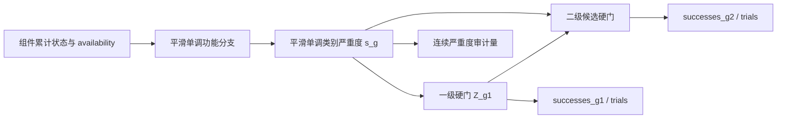

# 毁伤树与源项强度根因辨识论证

**日期：** 2026-10-15  
**对象：** `dataset_5000_loitering_impact_fragment_only_v1`、当前 fragment-only 目标定义、毁伤树与既有诊断证据  
**目的：** 判断七个任务中的恒零/极稀疏现象更可能来自毁伤树语义、几何可达性、源项/响应幅值，还是 Monte Carlo 分辨率，并给出可证伪的后续方案。  
**使用边界：** 本文只讨论仿真模型、数据合同和科研可辨识性，不提供提高现实破坏效能的参数或优化方案。

---

## 1. 结论先行

当前证据**不支持先把问题归因于“巡飞弹战斗部整体威力过小”**。更准确的判断是：

1. **毁伤树的科学语义确实不可靠，必须重审。** 当前树由原始表格中的数值通过人工配置映射到 `degraded/failed`，仓库自身将其标为 `provisional_requires_codebook_confirmation`；标签规范也是 `provisional`、`not_approved`。`effect-f1` 还存在一个未解析规则，因此任务定义本身不完整。
2. **但现有 OR 门或树求值器不是精确恒零的直接原因。** 五个多叶输出使用 `fully_dependent` OR，其实现是 `max(inputs)`；两个单叶输出是恒等投影。只要任一相关叶节点为正，系统输出就会为正。
3. **对当前 5000 例归档，恒零任务在“部件命中”之前就已经归零。** 新增的只读阶段审计显示，`effect-k1/k2/c1/c2` 对应部件在全部 5000 例中均没有正的破片命中、穿透、沉积能量、叶状态或系统输出。改变 OR 公式、降低状态阈值或单纯提高能量幅值，均不能修复“没有几何命中”这一前置事实。
4. **`effect-f1` 的稀疏也首先表现为可达性稀疏。** 全归档仅 28 例相关部件出现命中；这 28 例同时出现穿透、沉积能量、叶状态和系统输出。现有数据没有显示“已经命中但因威力不足而在穿透/响应环节大量归零”的独立瓶颈。
5. **源项、穿透和部件响应仍可能不真实，但目前不可从最终标签辨识。** 源项和响应模型均未独立标定，67 个部件共用同一个 demo 响应模型，正式归档又只执行破片机制。当前数据既不能证明真实战斗部足够，也不能证明其过小。
6. **最应优先检验的联合假设是：任务到部件/状态的映射不充分，加上坐标、源轴、目标几何或采样域使这些叶部件不可达。** 现有 18 例 outcome-blind Train 诊断中，稀疏任务相关部件的 6,120 条已追踪破片全部停在 `no_geometric_intersection`。

建议的调查顺序是：

> 任务语义与叶定义 → 坐标/几何/源方向可达性 → 采样域覆盖 → 遮挡与传播 → 穿透与部件响应 → Monte Carlo 分辨率 → 独立物理校准。

不应把“正样本变多”作为树或物理参数正确的验收标准。

---

## 2. 本次新增的直接证据

本次新增了只读审计脚本 `review_evidence/root_cause_tree_signal_audit_20261015.py`，将每个系统任务对应的部件辅助量、叶状态和树输出按 `case_id` 对齐。结果写入 `review_evidence/root_cause_tree_signal_audit_20261015.json`。该审计没有运行新的领域仿真，也没有改动正式归档。

归档由引擎 `0.7.0.dev1` 生成，当前源码包为 `0.7.0.dev2`。本次核对确认当前毁伤树定义哈希与归档冻结哈希一致，因此叶—任务对齐有效；但本文结论仍是对既有归档的诊断，不能代替当前源码的重新执行等价性验证。

### 2.1 全归档的“首次非零阶段”

下表统计的是 **5000 例全归档中的诊断性支持数**。现有 Test 已经被观察，因此这些数字只能用于根因定位，不能作为确认性性能结果。

| 任务 | 树结构 | 叶数 | 任一相关部件命中 > 0 | 任一相关部件穿透 > 0 | 任一相关部件沉积能量 > 0 | 任一叶状态 > 0 | 系统输出 > 0 |
|---|---|---:|---:|---:|---:|---:|---:|
| `effect-m2` | fully-dependent OR | 14 | 1770 | 1770 | 1770 | 1770 | 1770 |
| `effect-k1` | 单叶投影 | 1 | 0 | 0 | 0 | 0 | 0 |
| `effect-m1` | fully-dependent OR | 14 | 996 | 996 | 996 | 996 | 996 |
| `effect-k2` | 单叶投影 | 1 | 0 | 0 | 0 | 0 | 0 |
| `effect-f1` | fully-dependent OR | 6 | 28 | 28 | 28 | 28 | 28 |
| `effect-c1` | fully-dependent OR | 10 | 0 | 0 | 0 | 0 | 0 |
| `effect-c2` | fully-dependent OR | 10 | 0 | 0 | 0 | 0 | 0 |

同时：

- 七个任务均为 5000/5000 可用树输出；
- 对每个任务，`任一叶状态 > 0 但系统输出 = 0` 的案例数均为 0；
- `所有叶状态 = 0 但系统输出 > 0` 的案例数也均为 0；
- `effect-k1/k2` 的单叶投影没有出现提取或映射误差。

这组证据将当前现象定位得很清楚：

- `k1/k2/c1/c2` 的精确恒零首先发生在相关部件**没有命中信号**；
- `f1` 的稀疏支持与命中支持一致；
- 当前归档中没有观察到一个单独的“命中很多，但因为响应阈值过高而全部变零”阶段；
- 树在数值传播上忠实地复制了叶节点的非零支持。

这并不证明几何模型正确，只说明在当前教师模型内部，精确恒零的近因位于树之前。

### 2.2 Train-only 可达性诊断

既有 `fragment_reachability_train_audit.json` 具有以下边界：

- 从 3000 个 `reference_train` 案例中按预声明层次 outcome-blind 选择 18 例；
- 选择时未读取标签；
- 覆盖 `k1/k2/f1/c1/c2` 的相关叶部件；
- 每个相关部件汇总 6,120 条破片轨迹；
- 对这些部件，6,120 条轨迹全部为 `no_geometric_intersection`，其余 `blocked_before_component`、`hit_no_penetration`、`penetrated_no_damage`、`response_possible` 均为 0；
- 同一诊断记录了其他对象的交会，故并非射线求交模块整体失效。

该诊断还显示三个 profile 的声明源轴均与弹体速度方向相反。代码与测试证明这一坐标约定被稳定复刻，但没有证明其物理合理性。现有审计也明确把它限定为“坐标语义诊断”。因此正确结论是**必须核验轴向、起爆点和坐标变换语义**，而不是直接翻转轴向或把现状解释为真实物理。

18 例诊断不足以证明整个设计域结构性不可达；它遗漏了全归档中的少量 `f1` 正例。它的价值在于证明：对这批预声明案例，幅值和响应阈值不是最早失败环节。

---

## 3. 方向一：毁伤树是否定义不合理

### 3.1 “语义不合理”的风险很高

当前毁伤树并不是由已批准的系统失效定义推导出来的，而是由导入配置自动生成：

- 原始数值阈值通过 `threshold_state_map` 折叠为两个状态；其中两个不同原值都被映射为 `failed`；
- 单叶原始代码被转换为 `standard_projection`；
- 多叶原始代码统一转换为 OR；
- 多输入门统一采用 `fully_dependent`；
- `effect-f1` 有一个原始规则因阈值为空而未进入临时树；
- 一个原始部件因缺少三维位置被跳过；
- 目标元数据明确声明物理响应未验证、毁伤树需要 codebook 确认。

因此目前缺失的不只是“某个门选错”，而是七个任务各自的以下定义：

1. 系统事件究竟代表功能丧失、性能下降、部件损坏，还是某种原始编码；
2. 事件时间窗与持续性；
3. 哪些部件和状态是必要条件、充分条件或冗余路径；
4. 是否应使用 OR、AND、k-of-n、顺序逻辑或条件逻辑；
5. 叶事件之间的依赖依据；
6. 事件是否只能由破片机制触发；
7. 缺失规则应使任务 `unavailable`，还是定义一个新的、明确删减过的任务版本。

目前的标签规范只把七项声明为普通的非互斥 multi-label 事件，没有表达已有结构蕴含。例如：

- `k1` 的单叶同时属于 `m2`，当前定义蕴含 `k1 ≤ m2`；
- `c1/c2` 使用相同部件集合，分别对应较低/较高状态，当前定义应满足 `c2 ≤ c1`；
- `m2` 与 `c2` 还共享一个叶事件。

这些关系应进入标签合同、测试和模型评估，而不能只隐含在图结构中。

### 3.2 “树求值把正信号压成零”的假设基本被排除

对当前多叶任务，代码实现为：

\[
Y_t = \max_j p_{t,j}
\]

因而：

\[
Y_t=0 \iff \forall j,\;p_{t,j}=0.
\]

这是一种完美正依赖/共单调假设，不是从数据拟合出的相关性。它会影响概率幅度：相对于独立并集，它通常不累加多个弱叶的概率。但它不会把已经为正的叶变成精确零，也不会改变“是否存在非零支持”。

因此：

- **不能**通过把 `fully_dependent` 改成 `independent` 来宣称解决恒零；
- **不能**为了得到更多正标签而事后选择门或依赖模型；
- **可以**把依赖模型作为独立语义问题，用外部系统证据校准并报告 Fréchet 区间；
- 树仍可能因“选错部件、漏部件、选错状态或错误任务定义”间接造成恒零。

### 3.3 对七项任务的当前判断

| 任务组 | 当前判断 |
|---|---|
| `m1/m2` | 有大量非零，说明整个源项/求交/响应链并非普遍失效；树语义和依赖假设仍未验证。 |
| `k1/k2` | 单叶投影；恒零不能归咎于多叶 OR。应首先核验该单一部件是否真是任务的充分代表、其几何/坐标是否正确、该机制是否适用。 |
| `f1` | 任务定义不完整，且仅 28/5000 有支持。当前不应进入默认训练，更不能据其频率判断真实威力。 |
| `c1/c2` | 同一部件集的两个有序状态均恒零；现有归档中这些部件从未出现命中信号。应先核验组件集、位置和可达性，再讨论响应强弱。 |

---

## 4. 方向二：是否可能是战斗部源项或响应幅值过小

### 4.1 当前不能作出这一因果结论

最终系统标签可抽象为：

\[
Y=T\{R[P(G(S, X))]\},
\]

其中：

- `S`：破片源的生成与方向分布；
- `G`：坐标变换、几何相交和路径顺序；
- `P`：遮挡与穿透；
- `R`：部件状态响应；
- `T`：毁伤树；
- `X`：外层案例输入。

只观察 `Y=0` 不能区分上述任何一层。尤其当 `G=0` 时，后续幅值无论如何变化都不会进入部件响应。因此，“更多采样后仍为零”并不是“战斗部太弱”的充分证据；如果采样仍处于同一不可达几何域，它只会更精确地估计该域中的零。

当前还有四个不可辨识因素：

1. **正式数据只启用破片机制。** 它不能回答完整战斗部效应，也不能判断原始任务是否本来依赖被省略的机制。
2. **源项和响应均未独立校准。** 源项参数来自代码移植，物理注册表明确标为未验证；67 个部件共用一个 demo 部件响应模型。
3. **源项幅值与响应阈值存在尺度补偿。** 较强源项配较迟钝响应和较弱源项配较敏感响应，可能产生相似最终标签；没有中间量或独立观测时无法唯一识别。
4. **每个外层案例仅两个 Monte Carlo 重复。** 这会把小概率事件观测成零并使方差难以估计，但不能解释已明确分类为 `no_geometric_intersection` 的轨迹。

### 4.2 当前证据对“幅值过小”假设的约束

| 观察 | 对假设的意义 |
|---|---|
| `m1/m2` 在大量案例中命中、穿透、响应和系统输出均为正 | 排除“当前源项对整个目标完全无效”这一强说法。 |
| `k1/k2/c1/c2` 的命中、穿透、沉积能量、叶和系统支持均为 0 | 这些任务的精确恒零首先是可达性/映射问题；现有证据尚未进入幅值辨识阶段。 |
| `f1` 的命中支持与后续各层支持同为 28 | 当前归档没有显示一个独立的穿透或部件响应截断层；但样本少且任务不完整。 |
| 18 例逐破片诊断全部停在无几何交会 | 对该子集，增加能量幅值不是修复路径。 |
| 源项、装甲和部件响应均未验证 | 即使当前内部链路自洽，也不能外推真实威力。 |

所以目前最严谨的措辞应是：

> 现有合成归档不支持“战斗部整体威力过小”这一因果解释。对恒零任务，已观察到的最早失败阶段位于任务相关部件的几何命中之前；源项幅值和部件响应的真实合理性仍未验证，也不能由当前最终标签单独辨识。

---

## 5. 可证伪的根因辨识方案

### P0-1：先完成任务 codebook，再讨论物理参数

为每个任务建立版本化定义，至少包括：

- 功能事件的自然语言定义与时间窗；
- 部件集合及每个部件的必要/充分/冗余角色；
- 状态严重度和机制；
- 门类型及依赖证据；
- 原始记录到叶节点的逐条 lineage；
- 缺失规则、冲突规则和审批人；
- `task_definition_complete` 与 `approval_status`。

建议由两名独立领域人员先分别映射，再报告一致率和分歧处理。没有权威 codebook 时，可以保留“合成任务”身份，但不能赋予真实系统毁伤含义。

**停止条件：** `f1` 未解析规则未解决，或任一任务无法给出明确事件定义时，停止该任务的数据扩增和默认训练准入。

### P0-2：树的纯代数哨兵测试

不运行物理仿真，直接向叶节点注入人工概率：

1. 全零叶必须得到全零输出；
2. 每次只激活一个叶，输出必须与 codebook 预期完全一致；
3. 增大任一正向叶不得降低相应输出；
4. 对称门交换输入顺序后结果不变；
5. `standard_projection` 必须等于输入；
6. `fully_dependent` OR 必须等于最大边缘概率并落在 Fréchet 边界内；
7. 检查 `k1 ≤ m2`、`c2 ≤ c1` 等结构蕴含；
8. 未解析或不可用叶必须使相应任务不可用，不能静默按零处理。

这类测试只能证明实现符合定义，不能证明定义本身正确。

### P0-3：无武器语义的几何/传播 fixture

使用简单盒体、圆柱和确定性人工射线构造五类夹具：

1. 无相交；
2. 相交但被前序对象阻挡；
3. 命中但不穿透；
4. 穿透但人工响应为零；
5. 穿透且人工响应为正。

验证刚体平移/旋转不变性、四元数 `q/-q` 等价、镜像对称、交点排序、法向方向、阻挡顺序，以及 JSON/Parquet/NPZ 的一致性。响应使用人工 0/1 值，不使用真实源项参数。

**停止条件：** 任一夹具不能稳定落入预期类别时，停止对真实物理原因作解释。

### P1-1：建立完整 Train-only、输出盲的阶段审计

在预注册诊断池中，对每个任务固定输出：

```text
emitted
  → geometry_candidate
  → intersected
  → blocked_before_component
  → penetrated
  → response_positive
  → leaf_positive
  → tree_positive
```

要求：

- 仅使用 Train 或新建诊断池；
- 案例选择不读取输出标签；
- 覆盖预先声明的输入层，而不是搜索“最容易产生正例”的窗口；
- 以外层 case 为统计单位；
- 保存逐重复 trace、`successes/trials` 和机器可读的首个失败阶段；
- 将 `structural_zero`、`not_observed_at_current_R`、`unavailable_definition` 分开编码。

判定逻辑：

| 首个失败阶段 | 优先检查 |
|---|---|
| 无几何相交 | 部件映射、坐标系、源轴、起爆点、目标几何、采样域 |
| 有相交但被阻挡 | 交点排序、遮挡拓扑、材料路径 |
| 命中但无穿透 | 源项与穿透模型的组合；不能只改其中一方并宣称校准成功 |
| 穿透但无状态响应 | 部件响应模型、状态定义与单位 |
| 叶为正但树为零 | 树实现、节点引用或输出提取 |
| 树为正但数据标签为零 | writer、mask、顺序或序列化 |

### P1-2：分层、独立校准

必须按以下顺序冻结，并为每层保留独立验证集：

1. **几何与坐标：** 由独立 CAD/测量资料和双人 frame review 冻结部件位置、姿态、尺寸、起爆点和坐标变换。
2. **源项：** 使用授权且独立的表征数据验证质量守恒、方向与速度分布、坐标对称性及适用域。
3. **传播/穿透：** 用独立材料级证据校准，不使用最终七任务正例率反推。
4. **部件响应：** 按部件类别建立响应，而不是让所有部件共享未经验证的 demo 模型；状态定义必须与 codebook 一致。
5. **系统树：** 用 FMEA/FTA、明确的系统功能事件和专家一致性审查确定门与依赖。

对源项与响应参数计算 Jacobian 秩、Fisher 信息或后验相关性。如果二者高度共线，正式结论必须是 `unidentified`，不能强行归因。

Physics Registry 也应把以下字段从顶层状态扩展到每个具体模型：

- `calibration_id`；
- `validation_status`；
- `validity_domain`；
- 校准集与 holdout 的哈希；
- 拟合指标与不确定度；
- 失效和域外规则。

### P1-3：Monte Carlo 分辨率研究

在冻结的诊断案例上使用共同随机数和预声明的重复次数序列，报告：

- 逐重复 `successes/trials`；
- 置信区间宽度；
- 排序和任务判定稳定性；
- 外层 case 与内部 replicate 的分离统计；
- 几何结构零与统计未观测零。

增加重复后出现稳定非零，只能说明原先分辨率不足，不能同时证明物理模型正确。无几何相交时继续增加重复，只会更精确地估计结构零。

### P2：冻结新版本后再生成深度学习数据

只有当任务语义、软件 fixture、几何、源项、响应和重复次数均通过各自验收后，才：

- 版本化目标、Registry、毁伤树和标签规范；
- 保留旧归档，不覆盖；
- 分离 Reference、Enriched Train 和 Challenge 数据；
- 新建密封 Reference Test；
- 重新评估每个任务的 soft-event mass、有效样本量和校准误差；
- 只将通过定义、校准和支持门槛的任务加入默认 learner contract。

---

## 6. 对深度学习衔接的直接影响

1. **恒零任务不能作为普通监督任务训练。** `k1/k2/c1/c2` 当前没有可辨识的输入—输出关系，应继续 mask/exclude。
2. **`f1` 不能因有少量正例就放行。** 它首先受任务定义不完整约束，其次才是样本量问题。
3. **不要用过采样或损失加权掩盖结构零。** 这些方法只能改变学习权重，不能创造不存在的物理支持或修复错误语义。
4. **不要通过调源项或树门把类别比例调到“好看”。** 这会使教师模型拟合预期分布，并把人为偏好写入标签。
5. **建议保留中间阶段标签。** 几何相交、阻挡、穿透、响应和树输出分别建 mask，可支持多阶段模型、失效分析和不确定度传播。
6. **结构约束应进入模型与评估。** 对已确认的有序/蕴含关系报告违反率；只有 codebook 批准后才可施加约束损失。
7. **训练与确认性评价必须重新分离。** 当前 Test 已被用于诊断，后续定稿后需建立新的密封测试集。

---

## 7. 可验收的产物与判定门槛

| 产物 | 最低验收要求 |
|---|---|
| `damage_codebook_v*.json` | 七任务定义、时间窗、部件、状态、机制、门和证据完整；无未解析规则 |
| `damage_tree_lineage.csv` | 每条原始记录到叶和输出的唯一可追溯映射 |
| `tree_sentinel_report.json` | 全零、逐叶、单调性、置换、投影和结构蕴含全部通过 |
| `toy_fixture_matrix.json` | 五类几何/传播情形全部落入预期首个失败阶段 |
| `train_stage_decomposition.parquet` | 每任务、每案例的分阶段计数、mask、`successes/trials` 完整 |
| `geometry_reachability_diagnostic.json` | outcome-blind、覆盖预声明 Train 设计层、无标签选择 |
| `source_calibration_card.json` | 独立来源、适用域、校准/holdout、守恒与不确定度通过 |
| `component_response_calibration_card.json` | 按部件类别验证；状态与 codebook 一致 |
| `replicate_convergence_report.json` | 预注册停止规则通过；结构零与未观测零分开 |
| `root_cause_decision.json` | 允许结论为 `unidentified`；记录每个假设的支持与反证 |

停止规则：

- 任务语义不完整：停止该任务扩增；
- toy fixture 失败：停止物理解释；
- 无几何相交：停止讨论幅值/响应阈值作为该批案例近因；
- 无独立校准数据：停止真实威力结论；
- Monte Carlo 未收敛：停止把观测零称为结构零；
- Test 已被观察：停止将其用于确认性评价。

---

## 8. 证据索引与复现

主要证据：

- `damage_engine/damage_tree.py:85-102,151-220`：fully-dependent 门和树求值；
- `damage_engine/raw_import.py:503-613,767-803`：阈值映射和临时树生成；
- `raw_data/target.rebuilt.fragment_only.v1.json:7039-7229,7575-7583`：七任务结构、临时状态和 F1 未解析规则；
- `raw_data/label_spec.loitering_impact.fragment_only.v1.json:1-27`：provisional/not-approved 标签规范；
- `review_evidence/optimization_20261014/system_learning_contract.json:519-621`：F1 阻断与 Train 支持；
- `review_evidence/optimization_20261014/fragment_reachability_train_audit.json`：18 例 outcome-blind 可达性诊断；
- `examples/physics.loitering_impact.json:1-147`：未验证源项与 demo 响应；
- `raw_data/case.loitering_impact.fragment_only.v1.json:113-134`：两个 Monte Carlo 重复；
- `review_evidence/root_cause_tree_signal_audit_20261015.json`：本次 5000 例阶段支持对齐结果；
- `review_evidence/root_cause_tree_signal_audit_20261015.py`：本次阶段审计脚本；
- `review_evidence/kmfc_ordinal_feasibility_audit_20261015.py/.json`：旧七输出直接有序化可行性、M 违例和严格 committed inventory 审计；
- `review_evidence/audit_impact_conditioning_20261015.py` 与 `impact_conditioning_audit_20261015.json`：5000 例当前接触不变量及方向/姿态唯一性只读重算；
- `review_evidence/kmfc_v0_component_support_audit_20261015.py/.json`：KMFC-v0 候选组件域、分支活动数与 K/F 支持重合审计。

复现命令：

```powershell
& 'D:\ProgramData\Anaconda\envs\pytorch312-lmdt\python.exe' `
  review_evidence\root_cause_tree_signal_audit_20261015.py

& 'D:\ProgramData\Anaconda\envs\pytorch312-lmdt\python.exe' `
  review_evidence\kmfc_ordinal_feasibility_audit_20261015.py

& 'D:\ProgramData\Anaconda\envs\pytorch312-lmdt\python.exe' `
  review_evidence\audit_impact_conditioning_20261015.py

& 'D:\ProgramData\Anaconda\envs\pytorch312-lmdt\python.exe' `
  review_evidence\kmfc_v0_component_support_audit_20261015.py
```

运行结果：四个脚本均成功完成，分别生成七任务阶段统计、旧任务有序化诊断、5000 例接触/输入偏置审计和 KMFC-v0 组件支持审计。脚本只读正式数据，输出独立审计 JSON；正式输入文件的审计前后哈希保持不变。

---

## 9. 对“平滑证据层 + 最终突变逻辑层”的补充论证

### 9.1 可行性判定

用户补充提出：在毁伤判定中采用多级门控，前级用平滑函数表达连续毁伤程度，最终一级仍用突变的逻辑门产生离散等级。该设想在数学、软件和深度学习标签合同上均**有条件可行**，也比“整棵树只用一级平滑门”更符合以下需求：

1. 部件响应和子系统能力通常存在程度变化，适合用连续、单调函数表达；
2. 等级 0/1/2 是人为定义的决策状态，最终仍需要明确、可审计的边界；
3. 必要条件、失效联锁和等级蕴含关系适合由最终逻辑层显式表达；
4. 连续中间量与离散最终状态同时保留，可让科研审计区分“接近阈值”与“完全没有前置信号”。

该结构不能绕过任务语义、几何可达性和独立校准。尤其在所有相关叶输入均为零时，满足零保持性质的平滑层仍必须输出零；若用非零截距或普通 sigmoid 尾部制造非零值，只会把结构零改写为人为伪正例。

### 9.2 推荐的逐重复计算顺序

设类别 $g\in\{K,M,F,C\}$，蒙特卡洛重复为 $r=1,\ldots,R$，组件累计状态证据为 $x^{(r)}_{i,1}$ 和 $x^{(r)}_{i,2}$，并要求：

\[
0\le x^{(r)}_{i,2}\le x^{(r)}_{i,1}\le1.
\]

推荐的计算链为：

```text
组件/机制累计状态
  → 平滑、单调、零保持的功能分支分数
  → 平滑、单调、零保持的类别严重度 s_g^(r)
  → 最终硬必要条件与有序阈值
  → 单个重复的 D_g^(r) ∈ {0,1,2}
  → 跨重复 successes/trials 聚合
```

最简的最终逻辑层可写为：

\[
Z^{(r)}_{g,1}=\mathbf 1\{B^{(r)}_{g,1}=1\}\,
\mathbf 1\{s^{(r)}_g\ge \tau_{g,1}\},
\]

\[
Z^{(r)}_{g,2}=Z^{(r)}_{g,1}\,
\mathbf 1\{B^{(r)}_{g,2}=1\}\,
\mathbf 1\{s^{(r)}_g\ge \tau_{g,2}\},
\qquad 0<\tau_{g,1}<\tau_{g,2}\le1.
\]

其中 $B_{g,\ell}$ 只承载经 codebook 批准的硬必要条件；没有额外必要条件时取 1。正的一阶阈值与零保持平滑层共同保证“没有任何前置信号”仍为等级 0。随后定义：

\[
D^{(r)}_g=
\begin{cases}
2,&Z^{(r)}_{g,2}=1,\\
1,&Z^{(r)}_{g,1}=1,\;Z^{(r)}_{g,2}=0,\\
0,&Z^{(r)}_{g,1}=0.
\end{cases}
\]

由于二级门以一级门为父条件，结构上恒有：

\[
Z^{(r)}_{g,2}\le Z^{(r)}_{g,1}.
\]

跨重复输出两个累计概率估计：

\[
q_{g,1}=\frac{\sum_r Z^{(r)}_{g,1}}{R},\qquad
q_{g,2}=\frac{\sum_r Z^{(r)}_{g,2}}{R},
\]

因而必然满足：

\[
0\le q_{g,2}\le q_{g,1}\le1.
\]

三个互斥等级概率为：

\[
P(D_g=0)=1-q_{g,1},\quad
P(D_g=1)=q_{g,1}-q_{g,2},\quad
P(D_g=2)=q_{g,2}.
\]

这与当前 `LabelSpec` 已支持的 `ordinal_cumulative` 语义一致；`ordinal_class_probabilities()` 已能拒绝非单调累计概率并转换为三级互斥概率。

### 9.3 硬门必须位于重复内部

最终逻辑门应在每个蒙特卡洛重复内部执行，再聚合事件计数。一般情况下：

\[
\frac1R\sum_r \mathbf 1\{s^{(r)}\ge\tau\}
\ne
\mathbf 1\left\{\frac1R\sum_r s^{(r)}\ge\tau\right\}.
\]

例如两个重复的严重度为 0.9 和 0.1、阈值为 0.6：前者得到事件频率 0.5，后者把平均严重度 0.5 判为 0。后一做法丢失了重复内异质性，并把事件概率问题变成“平均分数是否越界”的另一个问题。

当前引擎已经在每个重复内计算机制状态并求值毁伤树，随后才聚合组件、装甲和树输出；因此总体调用位置是合适的。新实现需要把树求值扩展为同时返回：

- 每个重复的功能分支分数；
- 每个重复的类别严重度 $s_g^{(r)}$；
- 每个重复的 `level_ge_1`、`level_ge_2` 硬指示；
- 每个案例的 `successes_g1/trials`、`successes_g2/trials`；
- 连续严重度的均值、离散度和必要的分位数；
- 门参数、数值容差、边界比较规则和校准制品哈希。

当前正式归档 $R=2$，累计概率只能取 0、0.5 或 1，不能支撑精细概率校准。新树试验必须先通过预注册的重复数与收敛研究，并保存可重算的重复级证据。

最终硬门产生二元事件后，不能继续用普通均值的 Student-t/正态区间处理稀有事件。当前统计实现会把 0/32 成功报告为均值、标准差和区间全为 0，但这不表示真实概率已知为零。新版本应为 `successes/trials` 使用预声明的 Wilson、Jeffreys 或其他经验证的二项区间；两级联合不确定性应基于 `[n0,n1,n2]` 的多项计数处理。自适应停止也必须使用同一事件统计合同。

### 9.4 “平滑分数”和“事件概率”不能混名

平滑层有两种不同的科学语义，必须二选一并写入 schema：

1. **严重度分数：** 平滑层输出 $s_g\in[0,1]$，最终由确定性阈值产生等级；这是本项目当前更清晰的推荐解释。
2. **经校准的累计事件概率：** 平滑层直接输出 $q_{g,1},q_{g,2}$。如果仍要在重复内采样硬状态，两个等级必须共享同一个 $u\sim U(0,1)$：

\[
Z_{g,1}=\mathbf 1\{u\le q_{g,1}\},\qquad
Z_{g,2}=\mathbf 1\{u\le q_{g,2}\},
\]

不能独立采样两个 Bernoulli，否则可能出现二级为真而一级为假的非法状态。

未经独立系统级观测校准的连续分数只能命名为 `severity_score` 或 `continuous_response`，不能直接命名为真实概率。本文后续默认采用“连续严重度 + 硬等级”的第一种解释。

当前树叶在单个重复内主要是组件状态概率，而不是已经实现的 0/1 组件状态。因此，对这些概率先做平滑汇总再硬阈值，严格估计的是“项目判据分数越界概率”，建议命名为 `criterion_exceedance_probability`。如果未来要把输出解释为物理系统状态的实际发生概率，应先定义并验证组件联合状态及其依赖，再对实现状态运行确定性系统逻辑；不能默认独立抽样。

### 9.5 平滑层的最低数学约束

任何候选函数都必须满足：有界、有限、输入单调不减、全零输入输出零、缺失输入不被当成零、参数可追溯。可作为候选的函数包括：

- 零锚定 Hill 函数或有精确零区的 smootherstep；
- 非负权重的幂平均或经约束的单调样条；
- 具有明确替代路径语义的 noisy-OR；
- 具有独立性证据时的 Poisson-binomial `k-of-n` 尾概率；
- 有必要条件与冗余路径定义的分层单调组合。

门函数由系统语义决定，不能根据哪一种能增加正例而选择。普通无约束 MLP 不宜直接作为教师树节点；若确需可学习门，应使用非负权重网络、单调格点或单调样条，并把单调性、零保持、参数来源和适用域作为可机检合同。

---

## 10. 四类 KMFC、每类两级的重构边界

### 10.1 旧七输出不能直接改名为新八输出

新合同应有八个累计输出：

- `effect-k1 = P(K≥1)`、`effect-k2 = P(K≥2)`；
- `effect-m1 = P(M≥1)`、`effect-m2 = P(M≥2)`；
- `effect-f1 = P(F≥1)`、`effect-f2 = P(F≥2)`；
- `effect-c1 = P(C≥1)`、`effect-c2 = P(C≥2)`。

K、M、F、C 是四个可同时发生的有序类别，类别之间不能使用 softmax 强制互斥；每一类内部才有 0/1/2 三级互斥状态。

现有七输出不满足这一合同：

| 类别 | 当前结构事实 | 能否直接作为两级有序对 | 重构要求 |
|---|---|---|---|
| K | K1 与 K2 分别是两个不同部件、不同事件的单叶投影 | **不能** | 先确认 K 的统一功能事件与严重度轴，再建立共同分支与父子等级 |
| M | M1 与 M2 使用不同部件集合；全归档若把 M1/M2 当累计对，会出现大量 `M2>M1` | **不能** | 先建立统一功能图，再从同一潜在严重度或显式父子门派生两级 |
| F | F1 缺一条原始规则，多个相关部件未分配，F2 不存在 | **不能，当前阻塞** | 先补齐 codebook、叶 lineage 和 F2 定义，再进入软件原型 |
| C | C1/C2 使用同一人员集合的较低/较高组件状态 | **仅具结构雏形** | 仍需确认角色、人数、冗余与时间窗，不能继续默认 `max(any person)` |

对现有 5000 例，M1 非零 996 例、M2 非零 1770 例；逐例把旧 M1 当一级、旧 M2 当二级会出现 1346/5000 个 `q2>q1` 违例。这是直接证据，说明旧任务不是有序等级，不能通过重命名解决。

### 10.2 推荐的统一树模板

四类应共享结构规范，但使用各自经批准的功能图：



逐类建议只限定结构，不在现有证据不足时填写真实参数：

- **K：** 现有两个单叶事件不能证明存在严重度顺序。先由 codebook 明确 K 的中文含义、功能事件和时间窗；若专家结论认为两者其实是不同模式，则应拆成不同任务，不能为了满足两级形式强行排序。
- **M：** 可在确认语义后，把推进/传动、行走机构和操纵等分支组织成统一单调功能图，再定义部分功能下降与更严重功能丧失。具体成员、必要/充分关系、冗余、权重和阈值均待外部依据确定。
- **F：** 先解决缺失规则和 F2 空缺，并审查尚未分配的相关功能部件。结构上可使用多个子功能分支，但是否纳入、如何串并联必须由 codebook 与独立证据决定。
- **C：** 现有同一部件集的低/高状态最接近有序结构，可作为软件原型；正式树仍需定义角色差异、人数效应、冗余与任务时间窗。

在把树解释为物理毁伤标准时，所有数值权重、曲线形状和阈值均应标记为 `TBD_external_calibration`，不得按标签比例设定。若项目明确改为下节所定义的“专用合成教师”，则允许在独立的 Tree-Design Calibration 数据上，以预注册的覆盖目标选择单调变换和阈值；此时输出只能解释为项目内相对等级，且绝不能使用已观察的 Validation/Test 反调参数。

### 10.3 缺失与不可用语义

缺失部件、缺失机制、未批准规则或无法解析的叶必须产生 `unavailable` 与 mask，不得用 0 代替。等级 0 的严格含义应是：

> 在输入、机制、树定义均可用，并满足正式接触条件的前提下，该 KMFC 类别没有达到等级 1。

因此，`unavailable`、`no contact` 和 `level 0` 是三个不同状态，必须分别存储和评价。

---

## 11. 面向本项目的专用毁伤树与等级均衡设计

### 11.1 修改后的研究目标是可行的

用户进一步明确：最终目的不是得到跨目标、跨任务均适用的通用毁伤树，而是得到只对本项目有效的专用树；在保持较为客观、可解释和可复现的前提下，使 K/M/F/C 各等级在本项目输入域内具有较全面、较均匀的支持，以提高神经网络训练效率。

这一目标**可行**，但必须把科学主张改写为：

> 在冻结的目标版本、破片机制、首次装甲接触条件、输入支持域和设计分布 $p_0$ 内，构造一个项目专用、单调、有序、可复现的合成教师，使其三级 KMFC 输出具有预声明的学习覆盖；训练所得模型用于逼近该合成教师，而不是直接估计现实总体毁伤概率。

这类树的客观性不来自“它等同于真实世界”，而来自以下可审核程序：范围事先冻结；输入到标签的映射单调且零保持；候选函数和选择准则预注册；树设计、模型训练与最终测试严格分离；所有参数、数据和选择轨迹可重算；负结果和不可达状态不被隐藏。

专用化是合理的，前提是名称和 manifest 显式绑定：

- 固定目标/几何版本；
- `fragment_only` 机制范围；
- `contact_conditional` 估计量；
- 明确的 profile、接触表面、来向、速度和姿态支持域；
- codebook、树、阈值、校准池和输入 schema 的内容哈希；
- `scientific_claim_scope = project_specific_simulator_emulation`；
- `physical_generalization_status = not_established`。

### 11.2 “较全面、较均匀”应作为设计目标，不应等同于现实发生率

若项目没有可验证的实际总体分布，采用一个人工设计分布作为学习基准本身并不错误。可以预先声明每类三级的目标边际分布：

\[
\boldsymbol\pi_g=(\pi_{g,0},\pi_{g,1},\pi_{g,2}),\qquad
\sum_{k=0}^{2}\pi_{g,k}=1,
\]

并在专用校准池中选择满足语义硬约束的树，使观测等级分布接近该目标。目标可以偏向均匀，但不建议把“每类恰好各占三分之一”设为硬验收条件，原因是：

1. 离散有限样本、重复随机性和大量相同分数使精确均匀通常不可达；
2. 四类是可并发的多任务，边际均匀不意味着 (3^4=81) 个联合组合均匀；很多组合可能受结构关系限制；
3. 强迫精确均匀容易把阈值推到噪声密集区，放大微小数值扰动；
4. 如果某类大量样本的前置证据精确为零，任何零保持树都无法把它们客观地拆成 1/2 级；随机打散并贴标签会破坏可解释性。

因此推荐的验收目标是“**最低支持 + 不过度集中 + 稳定**”，包括：每个合法边际等级达到预注册的案例数、soft mass 和有效样本量下限；主要输入层和接触表面均有覆盖；合法的关键成对组合有支持；bootstrap 或独立批次中的等级比例和阈值稳定。不得要求所有联合格子等频。

### 11.3 客观性应由硬约束和独立选择流程保证

建议使用分层而不是混合的优化准则。

第一层是任何候选树都不得违反的硬约束：

- 组件和功能分支来自版本化项目 codebook；
- 平滑层有界、单调、零保持；
- 缺失输入传播为 unavailable；
- 二级逐重复蕴含一级；
- 类别内阈值顺序固定；
- 一级与二级切点具有预声明的最小间隔，避免中间等级数值上消失；
- 复杂度上限、最大斜率和数值容差预声明；
- 不改变源项、穿透或响应参数来迎合标签比例；
- 不读取 Validation/Test 选择树。

第二层只在满足全部硬约束的候选中选择。可使用预注册的综合准则：

\[
J(\theta)=
\lambda_{\mathrm{bal}}\sum_g
D\!\left(\widehat{\boldsymbol p}^{\,\mathrm{cal}}_g(\theta),\boldsymbol\pi_g\right)
+\lambda_{\mathrm{stab}}C_{\mathrm{stability}}(\theta)
+\lambda_{\mathrm{sens}}C_{\mathrm{threshold\ sensitivity}}(\theta)
+\lambda_{\mathrm{comp}}C_{\mathrm{complexity}}(\theta),
\]

其中 $D$ 可为预先指定的分布距离，稳定性项考察重采样/设计子域漂移，敏感性项惩罚大量样本堆积在阈值附近，复杂度项限制分支和参数数量。所有 $\lambda$、候选函数族、停止规则和并列决策必须在查看最终评价集之前冻结。

这一过程不是现实物理标定，而是透明的“教师任务设计”。报告中应同时给出：所选树、所有被比较候选、选择指标、参数不确定性、拒绝原因和独立验证表现，避免只呈现最有利结果。

树选择目标不得包含下游神经网络在 Validation/Test 上的准确率，否则会形成“选择最容易被某一网络预测的标签，再用该网络的高准确率证明标签合理”的循环论证。树冻结以后若因模型结果再次修改结构、映射或阈值，必须提升标签本体版本，并重新生成独立密封 Test。

### 11.4 可执行的专用平滑归一化方案

若某类别已经具有非退化、连续且语义排序可信的原始严重度 $s_g$，可在独立 Tree-Design Calibration 池上拟合零锚定的单调映射：

\[
u_g=T_g^{\mathrm{cal}}(s_g),\qquad u_g\in[0,1],
\]

其中 $T_g^{\mathrm{cal}}$ 可取带正则化的单调样条或平滑累计分布映射。随后用两个冻结切点将 $u_g$ 映射到 0/1/2 级，并通过父子硬门保证有序。

该做法近似保留样本严重度排序，同时能让训练域中的等级比例接近预声明目标；它是“项目设计分布内的相对严重度分级”，不是绝对物理阈值。必须满足：

- $T_g^{\mathrm{cal}}(0)=0$，不把无前置信号样本提升为毁伤；
- 相同输入产生相同输出，不通过随机破同分制造均衡；
- 单调映射和切点只用 Tree-Design Calibration 池确定；
- 如果 calibration 池来自富集采样，必须以冻结参考测度的 design weight 拟合映射和分位点，不能用未加权富集频率定义等级；
- 大量精确零或不可达时停止该类均衡，先修复上游可达性或改变预声明采样支持域；
- 映射、切点与校准池哈希冻结后，不能因 Validation/Test 分布不均再次调整。

若类别严重度仍有大原子质量或只取少量值，优先通过扩大合法接触几何覆盖、增加重复分辨率和完善功能分支获得连续支持；不应用随机抖动、非零截距或标签翻转来伪造均匀。

### 11.5 数据分区必须增加“树设计校准池”

建议新数据流程至少分为：

| 数据流 | 是否可看标签 | 用途 | 是否用于最终指标 |
|---|---|---|---|
| `tree_design_calibration` | 可以 | 选择专用树候选、单调映射和切点 | 否 |
| `model_train_reference` | 可以 | 在冻结树和 $p_0$ 下训练、估计设计内损失 | 否 |
| `contact_enriched_train` | 可以 | 改善稀有等级和边界样本的训练支持 | 否；单独报告 |
| `model_validation` | 可以，但不得回调树 | 选择网络结构、早停和训练超参数 | 否 |
| `sealed_reference_test` | 冻结前不可看 | 一次性评价冻结树对应的模型 | 是 |
| `geometry_ordinal_challenge` | 按预案 | 边界、域外和单调性压力测试 | 只作挑战报告 |

切分必须按独立研究单位、场景组或 lineage 在任何结果驱动选择前完成。当前 Test 已被观察，不能改作新的 `sealed_reference_test`。

如果仅靠树定义不能达到覆盖目标，可以在**树冻结后**构造 `contact_enriched_train`：允许按等级或边界区域富集，但必须保存 proposal、inclusion probability、design weight 和选择原因。Reference 仍保留预声明 $p_0$；网络 minibatch 可近似平衡，但概率校准与总体风险只能在 Reference 上计算。

### 11.6 对神经网络训练的合理预期

更全面的等级支持通常会带来以下工程收益：减少恒零输出头；增加少数等级的有效样本量；减轻联合损失被多数级主导；让有序头、校准曲线和分层误差可估计；降低只预测常数也能获得高准确率的风险。因此，在“逼近冻结专用教师”这一目标下，训练可能更高效，宏平均性能和等级边界学习也更有意义。

但它不保证所有指标必然提高。标签边界过陡、阈值附近噪声大、四类高度相关或平衡训练与 Reference 分布差异过大时，概率校准可能变差。必须同时报告：

- Reference 上的逐类 Brier/log loss、RPS 和可靠性；
- Balanced/Enriched Train 与 Reference 的分布差异；
- 每级案例数、soft mass、ESS 与外层 case 置信区间；
- 阈值邻域误差和对阈值扰动的敏感性；
- 常数、有序逻辑回归和小型 MLP 基线；
- 计算成本、收敛速度和多 seed 方差。

“更准确”只能表述为对冻结专用教师和冻结设计分布的预测误差更低；不能据此推导对现实毁伤更准确。

### 11.7 本项目的可行性边界

该专用化方案目前对 M 和 C 更容易形成软件原型；K 与 F 仍需先解决共同严重度轴、缺失规则和内部部件可达性。当前 K/C 相关叶在归档中没有几何命中信号，F 极稀疏；在这些前置问题解决前，任何要求三级近似均衡的优化都会失败，或者只能通过违反零保持/语义约束制造标签。

因此，专用化并不降低前置审计要求，而是允许在前置条件通过后，把“学习覆盖”合法地加入树选择目标。建议使用两项并列状态：

- `project_specific_benchmark_admission`：依据定义、覆盖、稳定性、泄漏和可重建性判断；
- `physical_validity_admission`：继续保持独立，当前为 `refused/not_established`。

前一项通过后即可开展严谨的专用模拟器代理学习；后一项未通过时，报告不得使用现实效能或真实概率措辞。

### 11.8 可进入校准实验的 KMFC-v0 具体候选

在“仅服务本项目”的前提下，可以把结构进一步具体化。以下是依据当前目标中的组件名称形成的候选 codebook；它冻结项目任务的组件域，但不宣称是外部通用毁伤标准。

| 类别 | 项目内严重度定义 | 候选分支与组件 |
|---|---|---|
| K | 关键储能/弹药单元的相对严重度 | `fuel_store={003}`；`ammunition_store={046,053,054}` |
| M | 机动功能的相对受损程度 | `powertrain={001–003}`；`drive_and_idler={004,005,030,031}`；`right_carrying={006–011,018–020}`；`left_carrying={012–017,021–023}`；`suspension={024–029}`；`right_track={032–035}`；`left_track={036–039}`；`mobility_operator={058}` |
| F | 观察、火控和武器链的相对受损程度 | `sensing={040–042}`；`fire_control={043,044}`；`weapon={045,050–052}`；`feed_and_ammunition={046,049,053,054}`；`countermeasure={047,048}` |
| C | 乘员与载员功能的相对受损程度 | `essential_crew={058,059,060}`；`embarked_personnel={061–067}` |

K/F 共享弹药组件、M/C 共享驾驶员是显式依赖，不是错误；四类本来就允许同时发生。`component-057` 当前未导入，任何未来依赖它的分支必须返回 unavailable。`055–056` 通讯天线和 `068` 炮台装甲暂不纳入 KMFC-v0，后续改变必须提升 codebook 版本。

按该候选域对现有 5000 例的案例级平均沉积能量做只读诊断，任一组件正支持数为 K=28、M=2205、F=28、C=0；K/F 的 28 个正案例集合完全相同，均只由 `component-054` 提供。M 中 2795 例无正分支、874 例恰有一个正分支、1331 例至少两个正分支。因此 M 可以立即进入独立原型校准；K/F 仍不足以形成互相独立且稳定的两级；C 必须先解决可达性。该统计读取了全部已观察 split，只是设计诊断，不能用作正式阈值拟合。

平滑层优先使用逐重复的连续沉积能量或等价穿透剂量，并由真实相交/穿透证据启用：

\[
u_{i,r}=\begin{cases}
0,&D_{i,r}=0\text{ 或无 admissible penetration evidence},\\
\dfrac{D_{i,r}^{\rho_g}}{D_{i,r}^{\rho_g}+s_g^{\rho_g}},&D_{i,r}>0.
\end{cases}
\]

KMFC-v0 固定 $\rho_g=1$，尺度 $s_g>0$ 由独立 calibration 池在冻结参考测度下拟合，同构左右组件共享尺度。这样能保留当前低重复次数下组件状态概率之外的连续排序，同时保持全零输入为零。

若逐重复剂量暂时不可用，才把累计状态转成备选归一严重度：

\[
z_i=\frac{q_{i,\ge\mathrm{degraded}}+q_{i,\ge\mathrm{failed}}}{2},
\qquad
0\le q_{i,\ge\mathrm{failed}}\le q_{i,\ge\mathrm{degraded}}\le1.
\]

该式是组件 $0/1/2$ 状态的期望等级除以 2。`dose_hill` 与 `state_expected_severity` 应作为两个显式候选，未证明无重复计数前不得相加。分支和类别均使用零锚定加权幂平均：

\[
G_p(\boldsymbol z;\boldsymbol w)=
\left(\frac{\sum_iw_iz_i^p}{\sum_iw_i}\right)^{1/p},
\qquad p\in\{1,2,4\},\quad w_i>0.
\]

左右对称组件默认等权；先在每个功能分支内部归一，再在分支间等权，避免组件多的分支天然占优。第一轮只比较预注册的 $p\in\{1,2,4\}$ 和少量角色组权重，不允许逐组件自由拟合大量权重。

每类从共同 $S_g$ 逐重复生成父子硬门。校准时用三个独占等级的 design-weighted soft mass：

\[
m_0=\sum_iw_i(1-q_{1,i}),\qquad
m_1=\sum_iw_i(q_{1,i}-q_{2,i}),\qquad
m_2=\sum_iw_iq_{2,i}.
\]

可以把归一 soft mass 接近三等分作为选择中心，但建议用每级 `[0.20,0.45]` 的初始工程带，同时检查设计加权 ESS、归一化熵、阈值邻域密度、bootstrap 稳定性和不同接触子域稳定性。该区间只用于首个 pilot 的预注册工程门，不是物理规律。若某类精确零质量超过允许上限，则返回 `coverage_unreachable`，先扩展合法接触支持域或修复组件可达性，不得把阈值降到 0、增加底噪或随机拆分同分样本。

当前 5000 例不能用于确定最终数值阈值：其 Test 已被观察，方向/姿态基本固定，K/C 在前置几何阶段归零，F 只有窄支撑，而且 $R=2$。因此，本轮已经完成“结构重定”和“选择算法重定”，最终 $p_g$、组权重与 $\tau_{g,1/2}$ 必须在新建、独立、带设计权重的 `tree_design_calibration` 池上拟合并冻结。

---

## 12. 需要修改的软件与数据合同

### 12.1 毁伤树 schema 与求值器

当前 `functional` 节点不是通用激活函数；在 `damage_tree.py` 中它仍调用 `probability_k_of_n()`。当前 target schema 也只允许固定逻辑节点、`k` 与两类依赖模型。新版本不应静默改变旧 `functional` 的语义，而应增加白名单节点，例如：

- `monotone_aggregate`：输出连续严重度；
- `hard_ordinal_gate`：执行最终有序逻辑；
- 或把有序门作为独立、版本化的 `ordinal_projection` 制品。

每个节点至少记录：`semantic_role`、`family`、输入和输出单位、零保持/单调合同、参数及约束、参数来源、校准集与 holdout 哈希、适用域、批准状态。JSON 中不得嵌入任意 Python 表达式或动态 callable。

### 12.2 标签与归档

新 LabelSpec 应定义四个 `ordinal_cumulative` 任务，每个任务绑定 `level_ge_1` 与 `level_ge_2` 两个输出。旧七任务归档不得原地覆盖；新树、新标签规范、新目标/Registry 和新数据集均使用新版本与内容哈希。

每个正式案例至少保存：

- 两级 `successes`、共同 `trials` 和 availability mask；
- 三级互斥概率及其可重算关系；
- 严重度连续摘要和可选的逐重复 trace；
- 树、codebook、校准制品、目标、Registry、输入 schema 与引擎代码哈希；
- `threshold_ambiguous` 或相应不确定性标记；
- Reference/Enriched/Challenge/Diagnostic 数据角色。

### 12.3 深度学习接口

模型端应使用四个有序头，而不是八个互不约束的二分类头。例如：

\[
\hat q_{g,1}=\sigma(a_g),\qquad
\hat q_{g,2}=\hat q_{g,1}\sigma(b_g),
\]

从结构上保证 $\hat q_{g,2}\le\hat q_{g,1}$。有重复计数时优先用二项或 beta-binomial 似然；若使用累计 soft-label BCE，必须应用 availability/uncertainty mask，并将设计权重、任务权重和 minibatch 抽样概率分开保存。

评价至少包括：两个累计事件各自的 Brier score 和 log loss、三级 ranked probability score、可靠性曲线、`q2>q1` 违反率、case-level bootstrap 区间、按设计域分层的性能和不同重复数下的稳定性。Focal Loss 不能作为默认概率校准目标。

### 12.4 必须新增的反例测试

1. 全零输入得到全零严重度与 0 级；
2. 任一正向输入增加不会降低严重度或等级；
3. `level2 <= level1` 在随机、边界和 float32/float64 测试中违反数为 0；
4. 缺失叶传播为不可用，不传播为 0；
5. 阈值等号、容差和最大斜率有确定规则；
6. 逐重复硬门再聚合，且反例能够检出“聚合后硬门”的错误实现；
7. 若采用概率采样，两级共享同一个随机数；
8. 逐叶激活只影响 codebook 允许的分支、类别和等级；
9. 三级概率非负且总和为 1；
10. 旧树在旧版本下结果保持不变。

---

## 13. “所有正式样本均朝向并接触目标”的采样规则

这一规则可纳入下一版，但它改变了研究估计量。正式数据应命名为 **Contact-Conditional Reference**，估计：

\[
P(D_g\ge\ell\mid C=1,\;p_0,\;\text{fixed target/version}),
\]

其中 $C=1$ 表示预先定义并可重算的首次装甲接触事件。它不能用于估计命中概率、制导质量、无条件毁伤概率、任务成功率或实际总体发生率。

建议将以下条款作为机器可验的 `S-CONTACT` 合同：

> 所有进入 `contact_conditional_reference`、`contact_enriched_train` 或 `contact_challenge` 的正式案例，必须在读取任何毁伤输出之前满足：轨迹起点位于装甲几何外；速度有限且非零；弹体约定前向轴与速度方向符合版本化对齐规则；沿速度正半射线存在装甲交点；保存的首次接触对象、接触点、时间、距离和法向能够由冻结目标几何重算一致。miss、反向交点、零速、起点在装甲内或姿态—速度不一致案例不得进入上述正式数据流。案例录取不得读取部件响应、树输出或最终标签。

“朝向目标”应由正向射线真实相交和姿态—速度一致定义，不能仅以指向目标质心的点积代替。还必须分别审查：速度方向、弹体 body 前向轴和源项自身方向轴；前两者一致不自动证明源轴正确。

当前 5000 例本来已经由 `first_armor_contact`、姿态—速度对齐和首次装甲射线求交约束生成。因此新增规则主要是把隐含条件升级为显式、版本化合同，**不会修复现有 K/C 恒零或 F 稀疏**；这些零发生在外壳接触后的内部部件可达阶段。当前数据还固定为单一来向、单一姿态，且只落在有限外部装甲表面，存在强条件化偏置。

下一版不应继续把“全部命中”实现成“单一来向”。建议采用结果盲的接触流形构造：先按冻结表面测度选择外装甲和表面片，再选片内接触点及预声明的可交入射方向，将起点沿反方向放在目标外，并令 body 前向轴与速度对齐。Reference 的表面片/方向权重必须在读取毁伤结果前冻结，不能按内部组件或标签挑选接触点；树冻结后的 Enriched Train 才可使用带选择概率和 design weight 的边界/稀有等级 proposal。审计中应至少输出唯一方向/姿态数、方向分箱覆盖、各表面片计数、接触点二维覆盖和分 split 一致性。

为验证 fail-closed 行为，仍应保留独立的 `invalid_geometry_diagnostic` 固定反例，包括 miss、reverse、zero-speed、inside-target 和姿态不一致。它们不生成正式毁伤标签、不进入训练/验证/测试，也不计入条件 Reference 指标。若未来研究端到端任务，应另建保留未命中的 `unconditional_encounter_reference`，不能从全接触数据反推总体命中率。

若下一版本让姿态或三维速度方向发生变化，这些变量必须作为部署时可得输入进入版本化 learner schema；当前学习输入只含 profile、起点 y/z 和正 x 速度，把变化后的姿态或横向速度继续藏在固定场景中会形成不可见混杂。

---

## 14. 实施顺序与准入门

### P0：先定义，后编码

1. 完成四类 KMFC 的 codebook，明确中文语义、时间窗、功能分支、必要/充分/冗余关系和等级定义；
2. 解决 F1 缺失规则与 F2 定义；确认 K 是否真正存在同一有序轴；
3. 冻结 `S-CONTACT` 条件事件、支持域、估计量和 learner 输入；
4. 预注册候选平滑函数族、最终硬门语义、阈值来源和拒绝规则；
5. 当前 Test 永久保留为诊断集，规划新的结果盲密封 Test。

### P1：实现与无害验证

1. 新增显式平滑节点和有序硬门，不修改旧节点语义；
2. 增加逐重复连续分数、硬状态及 `successes/trials` 归档；
3. 完成纯代数哨兵、几何 fixture、单调性、有序性、缺失传播和跨格式重算测试；
4. 用 Train/Calibration 数据完成参数辨识诊断；不可辨识时记录 `unidentified`；
5. 构造式生成满足 `S-CONTACT` 的样本，并记录尝试数、接受数与拒绝原因。

### P2：重新生成与科研验收

1. 冻结 codebook、树、阈值、目标、Registry、输入 schema、引擎 commit 和环境；
2. 分开生成 Contact-Conditional Reference、Enriched Train、Challenge 和 Diagnostic；
3. 完成共同重复数、置信区间与稳定性研究；
4. 只用新密封 Reference Test 做一次性确证；
5. 只有通过概率校准、有序一致性、支持度、版本重建和外部物理验证的任务才能进入正式 learner contract。

停止条件：任一类别没有批准的功能语义、阈值来源无法独立说明、几何 fixture 失败、重复数未收敛、`q2>q1` 非零、录取读取了结果，或新 Test 已被用于改模时，停止科研准入。

---

## 15. 最终科研判断

“毁伤树是否不合理”和“战斗部是否过小”不能用最终正例率二选一。当前证据支持以下结论：

- **现有毁伤树的语义和任务定义尚未达到科研准入要求；**
- **树求值器没有把已有正叶压成零，恒零任务首先缺少内部部件几何命中；**
- **源项和响应模型仍未验证，但当前标签不足以识别其真实幅值；**
- **四类 KMFC、每类 0/1/2 级的目标合同可行，但旧七输出不能原地转换；**
- **“平滑证据层 + 最终硬有序门”可行，并且是本项目比单一平滑门更清晰的候选结构；**
- **该结构必须逐重复求值、保存连续中间量和硬事件计数，并通过父子门保证二级蕴含一级；**
- **平滑门不会修复结构零；若明确定义为专用合成教师，可以把等级覆盖作为 Train-only 树设计目标，但不能把它解释为物理正确性；**
- **全接触采样只支持接触条件下的毁伤估计，必须明确其单一来向/姿态偏置和适用范围。**

因此，本方案应采用双状态判定：`project_specific_tree = feasible_pending_calibration`，`physical_validity = not_established`。它可以进入版本化软件原型、专用 Tree-Design Calibration、无害反例测试和新数据设计；在 codebook、几何可达性、有序硬门、覆盖稳定性、版本冻结和新密封测试通过后，可作为本项目专用合成教师及神经网络训练目标。它仍不能直接作为真实 KMFC 毁伤标准。旧 `m1/m2` 仅用于软件开发阶段的合成任务；旧 `f1` 因定义不完整而阻断；旧 `k1/k2/c1/c2` 因恒零而排除；任何现实效能结论继续拒绝。
