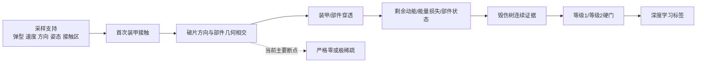

# 毁伤域采样稀疏性成因研究报告：项目内生性与人为方法因素辨识

**日期：** 2026-10-21  
**研究对象：** 巡飞弹撞击—破片毁伤仿真、5000 条 fragment-only 正式归档、旧七输出及候选 KMFC 两级任务  
**核心问题：** 当前毁伤域中的恒零与极端不均衡，是弹型、目标与毁伤机理必然导致，还是由采样、坐标、源项、树定义和数值方法等人为因素造成？  
**报告性质：** 仓库内证据审计、受控软件反事实、统计可辨识性分析与方法学调研；不是武器效能鉴定、实装参数确认或物理标定报告。  
**当前科研准入：** `research_admission=false`；现有 Test 已被观察，只能用于诊断，不能再作为确认性测试集。

---

## 摘要

本研究设置了三种竞争解释：

- **H1：项目内生稀疏。** 在合理且经物理批准的攻击包线、源项、目标响应和毁伤树下，KMFC 毁伤仍天然罕见且高度不均衡；
- **H2：人为/方法因素主导。** 固定来向与姿态、接触面、源轴、目标几何、毁伤树映射、重复数或生成方法制造了当前恒零；
- **H3：二者共同作用。** 人为设定造成当前可见的严格零，修复后仍可能保留由目标拓扑和严重毁伤定义导致的真实长尾。

**本轮裁决支持 H3，但两部分的证据强度不同：人为因素是当前严格零的已证实近因；真实物理系统是否仍然内生稀疏，是尚待测量的剩余问题。** 现有材料不支持“本项目的弹型—目标组合决定了标签必然恒零或极端稀疏”这一强命题。

主要证据如下。

1. 正式 5000 例全部满足首次装甲接触，弹型、y、z、速度在声明范围内覆盖正常；但全部样本只有一个速度方向和一个姿态。输入问题不是大量未命中样本，而是**条件接触域内的单侧、低自由度支持**。
2. 旧七输出中，K1、K2、C1、C2 为 `0/5000`，F1 仅 `28/5000`；K/C 的常量标签没有互信息和可学习方差，F1 的 Train 只有 11 个正例。
3. 机体 `+X` 与来袭速度 `+X` 对齐，三个 Taylor 破片源却均以 `-body-X` 为主轴。正式接触发生在车辆负 x 外表面；当前 dev3 的 120 条与不同代码身份下历史 Train 的 6120 条追踪中，审计到的破片 x 方向全部为负，主束因而主要朝向车辆外部/来路侧。两批轨迹只作为方向一致性旁证，不构成跨版本逐条复现。
4. 几何必要条件证明：从 `armor-001` 接触面沿负 x 飞行时，候选 K/M/F/C 部件分别有 `4/4、40/40、15/15、10/10` 被排除；从 `armor-002` 出发仍有 `3/4、19/40、13/15、10/10` 被排除。多个任务在穿透、能量与树门之前已经失去支持。
5. dev3 受控反事实跨 6 个入射方向、9 个接触网格和 3 个弹型；在每一个 `-body-X/+body-X` 配对工况内部固定目标、弹型、速度、姿态、接触点与随机种子，只改变源轴符号。在每种源轴条件各 150 个有效工况上，K/M/F/C 正能量支持率由 `10.0%/32.0%/8.7%/6.0%` 变为 `67.3%/96.0%/76.7%/86.7%`。这证明软件输出对人为坐标/方向设定高度敏感，也给出了“并非软件模型空间中的必然稀疏”的反例；它不证明 `+X` 在真实战斗部上物理正确。
6. 在旧归档中，只要相关部件发生 case 级命中，相同 case 也有穿透、正能量和叶节点支持；三档弹型在同一源轴下显著改变命中数量与剂量规模，却远不如源轴改变“是否存在支持”。因此，**战斗部威力不是当前严格几何零的领先近因**；但它仍可能影响一级/二级跨阈，且真实充分性未获验证。
7. 旧毁伤树没有把已有叶正例再次压成零，但其部件选择、M1/M2 等级关系、F 分支完整性和 C 语义均未获批准。候选重映射使 K 从旧标签 `0` 变为上游支持 `28`，说明树定义是重要人为因素；零锚平滑门仍不能从上游零剂量创造客观正例。
8. `R=2` 会放大未观测与量化问题，但不能修复确定性几何不可达。继续从相同设计分布盲目增加样本量，最可能得到对当前偏置更精确的估计，而不是恢复缺失机制。

因此，下一步不应先扩大数据量、放大战斗部或降低树阈值。最高优先级是：**裁决坐标与源轴语义，冻结同版本基线，按获准攻击包线开展方向/接触面×源项×威力×树版本的分阶段配对试验；在上游支持恢复后，再设计专用的零锚平滑证据层与有序硬门，并把 Reference 与富集 Train 分开。**

---

## 1. 问题定义与判定标准

### 1.1 观测分布依赖完整的仿真设计元组

对类别 $g\in\{K,M,F,C\}$，把当前标签写为

$$
Y_g=T_g\!\left(S_{\theta}\left(X,\omega\right)\right),
$$

其中：

- $X\sim p_0$ 是弹型、速度、方向、姿态和接触位置等外层工况；
- $\omega$ 是破片与响应的重复级随机量；
- $S_{\theta}$ 是由源项、目标几何、装甲/部件响应和实现版本 $\theta$ 决定的仿真链；
- $T_g$ 是类别毁伤树；
- 当前每工况重复数为 $R=2$。

所以观测发生率

$$
\pi_g^{\mathrm{obs}}=
\mathbb E_{X\sim p_0,\omega}
\left[\mathbf 1\{Y_g>0\}\right]
$$

只对一个冻结元组 $(p_0,\theta,T,R,\text{代码版本})$ 有意义。要证明“项目本性必然稀疏”，需要证明低支持对**经批准的攻击包线、经校准的源项/响应和合理树定义**具有稳健性，而不是只在一个自定义元组上出现。

### 1.2 四种“零”不能混用

| 术语 | 本报告中的含义 | 当前能否确认 |
|---|---|---|
| 归档观测零 | 当前 5000 例没有观测到正值 | K1/K2/C1/C2 可以确认 |
| 当前设计下的实际结构零 | 在固定方向、姿态、源轴、接触面与小 R 下，正例实际上不可观测或极难观测 | K/C 有强证据，F 有局部支持 |
| 数学结构零 | 在该随机模型的完整支持上严格不可能为正 | 尚未对 Taylor 高斯尾和全部几何完成形式化证明 |
| 真实物理零 | 在真实、可行任务域中不可能发生相应毁伤 | 当前完全不能确认 |

本报告使用“结构性”时，必须附带“在当前冻结设计/方向族内”的限定。

### 1.3 因果分层

对每个 KMFC 类别，非零事件可按链式概率分解：

$$
P(Y_g>0)=P(G_g)\,
P(P_g\mid G_g)\,
P(S_g\mid P_g,G_g)\,
P(T_g>0\mid S_g,P_g,G_g),
$$

其中 $G_g$ 表示几何可达/命中，$P_g$ 表示穿透，$S_g$ 表示正剂量和部件状态，最后一项是树映射。该式是链式法则，不要求各阶段独立。若 $P(G_g)=0$，放大能量、降低阈值、使用 Focal Loss 或复制样本都无法恢复真实正支持。



---

## 2. 数据、版本与证据等级

### 2.1 身份边界

| 对象 | 版本/身份 | 本报告用途 |
|---|---|---|
| 正式 5000 条归档 | `0.7.0.dev1`；engine hash `bf3b325e...` | 描述当前标签和输入分布 |
| 历史 Train-only 破片追踪 | engine hash `55cf8377...` | 有限、结果盲的方向/可达性诊断 |
| 当前工作区 | `0.7.0.dev3`；engine hash `e2bb0c4a...` | 当前实现审计与受控反事实 |

三者不是同一执行身份。dev3 反事实内部是严格配对的，但其效应量不能被写成 dev1 正式归档的精确反事实；当前源码也没有逐条复现旧归档。

### 2.2 证据等级

| 等级 | 含义 | 本报告实例 |
|---|---|---|
| A | 全归档重算或确定性几何事实 | 5000 例标签统计、方向/姿态唯一性、AABB 排除 |
| B | 同版本、配对的软件反事实 | dev3 源轴与六面向心接触试验 |
| C | 模型内推断或有限随机审计 | dev3 120 条与历史 6120 条破片方向、威力相对解释、R=2 影响 |
| D | 方法学文献或待验证物理假设 | 稀有事件方法、真实目标拓扑、真实战斗部充分性 |

任何 A/B 级软件证据都不能自动升级为真实物理结论。

### 2.3 本轮方法

本轮使用已安装的研究、统计与科研写作工作流，完成：

1. 全归档输入、标签、划分与 KMFC 候选上游支持统计；
2. 采样→接触→几何→穿透→能量→部件状态→树输出的逐层审计；
3. 负 x 射线与候选组件 AABB 的必要可达性证明；
4. dev3 中方向/接触面与 Taylor 源轴的受控析因反事实；
5. 类别熵、批次正例概率、Wilson 区间和深度学习可辨识性分析；
6. 稀有事件模拟、重要抽样、协变量偏移、长尾学习、不平衡评价、有序回归、两阶段模型与全局敏感性的定向文献核验；
7. 独立怀疑主义复核，专门检查版本混淆、因果过度外推与物理结论边界。

本轮没有修改生产物理参数、毁伤树或正式归档，也没有以当前不合格标签训练模型。

---

## 3. 正式归档的现状

### 3.1 输入覆盖：局部均匀不等于任务域无偏

当前 learner-facing 输入为三种弹型 one-hot、轨迹 y/z 和速度，共 6 维。5000 例中：

- 三种弹型约等量：large 1668、small 1662、medium 1670；
- y、z、速度的 10 个等宽箱大体均衡；
- y-z 的 10×10 网格占满 100/100，单格 31–73 例；
- split 间没有发现明显的 y/z/速度或弹型边际漂移；
- 首次装甲接触为 5000/5000；
- 归一化速度方向唯一值为 `[1,0,0]`，姿态唯一值为 `[0,0,0,1]`。

这说明**在声明的四个自由变量内部**，没有发现导致恒零的简单边际抽样漏洞；但来向、姿态、接触表面和相对几何被固定，因而存在更强的支持选择偏置。项目尚未定义现实任务分布，当前均匀设计也不能解释为 operational prevalence。

### 3.2 七个旧标签

| 标签 | 正值数/5000 | 零值率 | Train/Val/Test 正值 | 当前判定 |
|---|---:|---:|---:|---|
| `effect-m2` | 1770 | 64.60% | 1064/182/524 | 有支持，但不是已批准的 KMFC 二级语义 |
| `effect-k1` | 0 | 100% | 0/0/0 | 常量，不可学习 |
| `effect-m1` | 996 | 80.08% | 590/104/302 | 有支持，但与 M2 不嵌套 |
| `effect-k2` | 0 | 100% | 0/0/0 | 常量，不可学习 |
| `effect-f1` | 28 | 99.44% | 11/2/15 | 极端稀疏且高度局部 |
| `effect-c1` | 0 | 100% | 0/0/0 | 常量，不可学习 |
| `effect-c2` | 0 | 100% | 0/0/0 | 常量，不可学习 |

F1 的 28 个正例全部位于同一碰撞 x 平面，只覆盖 100 个 y-z 格中的 5 格。若把 M2 解释为二级、M1 解释为一级，则有 1346 例出现 `M2>M1`，证明旧任务不能直接改名为嵌套等级。

在把外层 case 暂按独立二项样本处理时，`0/5000` 的双侧 95% Wilson 上界约为 `0.0768%`；F1 的 `28/5000=0.56%` 对应约 `0.388%–0.808%`。这些区间只描述当前未验证设计，且会受共享目标、R=2、条件簇和已观察 Test 影响，不能外推真实物理概率。

### 3.3 候选 KMFC 上游支持

| 类别 | 候选部件数 | 任一命中 case | 任一穿透 case | 正能量 case |
|---|---:|---:|---:|---:|
| K | 4 | 28 | 28 | 28 |
| M | 40 | 2205 | 2205 | 2205 |
| F | 15 | 28 | 28 | 28 |
| C | 10 | 0 | 0 | 0 |

旧 K 标签为零，而候选 K 部件已有 28 个上游 case，直接证明**任务到组件的映射会改变支持集合**。K/F 的 28 例完全重合且只来自 `component-054`，说明它们仍受一个狭窄局部几何通道控制。C 则在组件命中前已经为零。

---

## 4. 根因辨识

### 4.1 固定来向、姿态与接触面是确定的人为限制

当前正式工况从负 x 侧沿 `+X` 方向飞向目标，单位姿态使机体 `+X` 与速度对齐。5000 例只落在两个负 x 接触平面：

- `armor-001`: x≈`-1.630265 m`，2789 例；
- `armor-002`: x≈`-1.187480 m`，2211 例。

因此数据集只回答“在该单侧来向并已发生首次装甲接触时，标签怎样分布”。它没有识别方向效应，也不能估计未命中率、制导质量或无条件毁伤率。全部正式样本满足接触合同这一点是正确的；问题在于接触流形过窄，而不是应该把反向飞行或未命中样本重新混入训练集。

### 4.2 Taylor 主轴与车辆内部方向相反

当前实现把 body `+X` 对齐来袭速度，而三个 Taylor 源均设置 `axis_body=[-1,0,0]`。引擎围绕该轴生成环锥，再叠加 80–160 m/s 的正 x 弹体速度。三个 profile 的 Gurney 速度约为 1.88–2.03 km/s，Taylor 环基准角约 25.4°–30.5°，再叠加 0–10° 环修正和 2° 展宽；实际审计到的初始破片速度约为 1.73–1.97 km/s，弹体平动项不足以反转主束。

直接审计结果为：

- 当前 dev3 模板 120 条破片：方向 x 为 `[-0.87410,-0.68731]`；
- 历史结果盲 Train 追踪 6120 条破片：large、medium、small 的方向 x 均严格为负。

这证明软件稳定复刻了“从负 x 接触面向更负 x/车外传播”的主束。由于所有源参数均标记为 `BISHE-SIMULATION-ENGINE-PARAMETERS-UNVERIFIED`，目前只能把它称为**高优先级坐标语义疑点**，不能直接称为 bug，也不能为了标签均衡直接翻轴。

### 4.3 几何必要条件解释了 K/F/C 的局部支持

若碎片从 $x_0$ 出发且 $d_x<0$，则对任意 $t>0$，$x(t)=x_0+t d_x<x_0$。若某组件 AABB 的最小 x 仍大于 $x_0$，射线必不可能与其相交。

| 接触面 | K 被排除 | M 被排除 | F 被排除 | C 被排除 |
|---|---:|---:|---:|---:|
| `armor-001` | 4/4 | 40/40 | 15/15 | 10/10 |
| `armor-002` | 3/4 | 19/40 | 13/15 | 10/10 |

该判据只是一项必要条件：被排除可证明不可达，未被排除不保证真正命中。它仍足以说明：在当前主束方向下，C 的全部候选部件连最粗的 x 方向条件都不满足；K/F 只有极少外侧部件可能获得支持。这与 C 为 0、K/F 仅由 `component-054` 产生 28 个 case 的事实一致。

### 4.4 配对反事实否定“软件模型空间中的必然稀疏”

dev3 反事实使用：2 个源轴条件 × 6 个朝向车辆的正交入射面 × 9 个接触网格 × 3 个弹型，共 324 个候选；300 个通过首次接触并进入分母，24 个未接触候选被记录为拒绝。所有有效样本的速度与姿态均朝向目标，不包含反向飞行或标签化未命中。

| 源轴 | 有效工况 | 任一组件命中 | K 支持 | M 支持 | F 支持 | C 支持 | 旧树任一非零 |
|---|---:|---:|---:|---:|---:|---:|---:|
| 当前 `-body-X` | 150 | 41.3% | 10.0% | 32.0% | 8.7% | 6.0% | 35.3% |
| 诊断 `+body-X` | 150 | 96.0% | 67.3% | 96.0% | 76.7% | 86.7% | 96.0% |

在保持当前 `+X` 入射面、接触网格、速度、弹型和种子不变的 27 对中，仅翻转源轴：K、F 各有 21 对从无支持变为有支持，C 为 27/27 对从无支持变为有支持。该反事实足以证明结果不对源轴设定稳健。

同时，只扩展来向而保持当前 `-X` 源轴，可把当前 `+X` 面上 K/F/C 的严格零变为其余五面合并约 `12.2%/10.6%/7.3%` 的支持。方向覆盖能解除严格零，但外向源轴仍造成严重稀疏。

这些比例来自规则诊断候选集，不是作战发生率；六个面也未按真实攻击频率加权。反事实的作用是定位敏感因素，而不是建议把生产源轴改为 `+X`。

### 4.5 战斗部威力：不是严格零首因，但尚不能宣布充分

对旧任务，case 级“任一命中→任一穿透→正能量→叶正值→树正值”没有进一步计数损失：M2 为 1770，M1 为 996，F1 为 28；K/C 在命中阶段已经为零。对候选 KMFC，K/M/F 的命中、穿透与正能量 case 也分别保持 28/2205/28。

反事实中，大弹型显著增加平均部件命中数量：当前轴下 small/medium/large 约为 `20.5/49.8/97.3`，诊断翻轴后约为 `71.1/188.1/396.3`；但同一源轴下，三档弹型对“某类别是否至少获得一个支持”的差异远小于源轴差异。这说明：

- 增强质量、数量或速度可以提高剂量和严重程度；
- 它不能让方向相反的射线穿过本来不可达的内部部件；
- 当前软件链的严格零首先是几何/坐标问题，而非总能量问题。

边界必须保留。装甲和部件响应均为 `DEMO-NOT-VALIDATED`；R04 高保真工况虽在 1200–2600 m/s 范围全部出现穿孔代理，但存活破片 part 均速候选代理随速度非单调，且 2000 m/s 三网格的该均速与存活质量响应严重不一致，尽管三网格穿孔代理分类一致；7 例中还有 5 例中心节点残速 QoI 不可用，因此 P0 响应标定被拒绝。R05 仅完成候选设计、静态校验、捕获账本算法与输出合同及合成状态测试，尚未提交或运行；实际 D3PART 可读性和捕获账本 availability 仍为 `PENDING`。因此 R04/R05 最多提供“不能把太弱当作已证实首因”的旁证，不能证明真实战斗部足够，也不能用于校准当前响应参数。

### 4.6 毁伤树：影响任务定义与等级比例，但不能创造上游物理支持

旧树所有任务均有 `leaf_positive_tree_zero=0`，说明求值器没有把已有叶正例吞掉。当前恒零的第一断点在树之前。然而树定义仍存在实质问题：

- K1/K2 是两个不同组件的不同叶事件，不能直接解释为同一严重度轴的一级/二级；
- M1/M2 组件集合不同并有 1346 个顺序违例；
- F1 分支不完整，且当前候选 K/F 又共享单一局部来源；
- C1/C2 看似 degraded/failed 两级，但组件响应和系统级语义未获批准；
- `functional` 在旧求值器中实际按 k-of-n 处理，不是连续平滑门。

对各类别部件能量应用零锚函数 $e/(e+T)$，令 $T=100,1000,10000\,\mathrm{J}$，正支持 case 集合完全不变。这不是树合理性的证明，而是零锚函数的性质：平滑门能调整已有信号的幅值和梯度，不能把全零上游证据变成客观正例。使用非零截距或 epsilon 把零剂量映射成正值，只会制造伪毁伤。

还必须区分两种能量：归档 `deposited_energy_j` 是穿透前后动能差，而当前部件 degraded/failed 响应使用穿透后的**剩余动能**。新平滑树若未经论证直接使用前者，会改变教师的因果语义。下一版需同时保存、分别命名和标定穿透前能量、能量损失、部件处剩余动能与部件状态概率。

### 4.7 `R=2` 与样本数：放大问题，不是首个断点

每个外层工况只有两次重复，导致：

- 稀有随机机制容易在本工况中未被观察；
- soft label 与硬事件计数具有粗粒度；
- 无法区分“真实条件概率极低”和“当前两次都没发生”；
- 对 F1，Train 仅 11 个正例，普通 iid batch=128 完全无正例的概率约为 62.5%。

但若几何上严格不可达，增加 R 只会更精确地重复零。正确顺序是先修复/裁决支持域，再在近边界工况上用嵌套 `R=4/8/16/32/...` 做顺序收敛。

同理，从相同 $p_0$ 继续盲目增加外层 N 只对当前设计发生率提高精度。以 F1 当前 0.56% 的点估计作粗略规划，得到 100/200 个正例约需 17,858/35,715 例；这是假定发生率稳定、case 独立且设计不变的条件估算，不是保证，更不能解决 K/C 的支持缺失。

### 4.8 仍可能存在的项目内生长尾

反事实没有排除以下物理机制：

- 关键部件相对整车投影面积小、遮挡路径长；
- 系统具有冗余，需要多个分支同时失效才进入高等级；
- 二级毁伤本就应比一级毁伤少；
- 合理攻击包线可能集中在少数方向；
- 经校准的破片角分布、质量谱和装甲响应可能使严重毁伤仍然罕见。

这些因素使“修复后仍然长尾”具有物理合理性。但当前目标几何、源项、响应和树 codebook 都未独立验证，无法量化它们的贡献，也不能把当前极端零率归功于它们。

---

## 5. 因素归因矩阵

| 因素 | 当前证据 | 对严格零的作用 | 当前裁决 | 优先级 |
|---|---|---|---|---:|
| 单一来向/姿态 | 5000 例各只有一个唯一值 | 限制可达面与方向效应 | 已证实的人为支持限制 | P0 |
| `-body-X` Taylor 主轴 | dev3 120 条与历史 6120 条审计轨迹 x 均负；配对翻轴大幅改变支持 | 主导内部组件不可达 | 强软件内因果证据；物理语义待核验 | P0 |
| 目标/组件几何 | AABB 排除与 28 例局部通道一致 | 决定可达性 | 强模型内证据；几何真实性未验证 | P0 |
| 战斗部强度 | 影响命中数/剂量，但非零支持远弱于轴效应 | 可能影响等级跨阈 | 不是当前严格零领先近因；真实充分性未知 | P1 |
| 毁伤树部件映射 | 旧 K=0，候选 K 上游=28；M 不有序 | 改变任务支持与等级语义 | 已证实重要，但不是 C 上游零的修复 | P0 |
| 平滑/逻辑门形状 | 零锚门不改变正支持集合 | 调幅、边界和梯度 | 上游恢复后才有意义 | P1 |
| `R=2` | 重复分辨率不足 | 放大未观测与量化 | 次生放大因素 | P1 |
| 外层 N=5000 | y/z/速度覆盖良好但固定来向 | 精确估计当前偏置 | 继续同分布扩样不能解决结构零 | P2 |
| 真实目标拓扑与冗余 | 尚无独立物理标定 | 可能形成剩余长尾 | 未辨识 | P0/P1 标定后判断 |

最稳健的因果表述是：

> **当前极端不均衡是一个特定、未验证仿真设计元组下的条件结果。固定来向/姿态、负 x 接触面与后向主束的组合，对严格零具有强软件内因果证据；毁伤树映射和 R=2 进一步改变或放大了不可学性。真实弹型—目标系统是否仍然内生长尾，尚未经过经批准物理域中的测量。**

---

## 6. 方法学文献对本项目的约束

### 6.1 稀有事件方法只在事件真实存在时有效

Au 与 Beck 的 Subset Simulation 把小失效概率写成一系列较大条件概率的乘积，适合沿“几何可达→命中→穿透→等级”构造中间事件。它不能从当前设计支持外创造事件，也不能把错误源轴或错误树变成真实物理。

Owen 与 Zhou 证明，多提议分布混合并配合控制变量，可以把重要抽样的渐近方差风险控制在最佳单一候选分量的一个小倍数内。**据此形成的项目应用建议**是：把 \(p_0\) 作为混合分量之一，同时把多个定向/接触区域作为可追溯的富集 proposal，并保存 $p_0/q$ 或可复算的选择概率。

### 6.2 改变物理或树不是普通协变量偏移

Sugiyama 等的 IWCV 在训练/测试输入分布不同而 $p(y\mid x)$ 不变的 covariate-shift 假设下，给出无偏的模型选择风险估计。改变源轴、目标响应或毁伤树会改变标签机制本身，不能靠重要性权重把旧数据校正成新物理；必须版本化并重新生成 Reference/Val/Test。

### 6.3 长尾损失不能解决零支持

Cui 等在其长尾图像基准上显示 class-balanced loss 可以改善性能；本项目只能在每类已有可信样本后，把它作为待验证训练基线。它不能从零正例、错误语义或上游零剂量中恢复信息，这是由本项目监督信号可辨识性得出的限制。Saito 与 Rehmsmeier说明，强不平衡下 PR 曲线比 ROC 更直接反映正预测可靠性，但 PR 评价同样需要足够的独立正例。

### 6.4 有序模型和两阶段模型的适用位置

CORAL 在共享权重约束下保证累计二元输出的 rank monotonicity，适合每类 `P(level≥1)`、`P(level≥2)`；它不验证等级语义。Mullahy 的 hurdle 模型可作为“先判断是否可达/有正剂量，再预测条件严重度”的结构类比，但原论文针对计数数据，本项目不能直接照搬其似然。

Sobol 全局敏感性可在输入分布获准、输出方差非零后分析方向、源项、威力与树参数的主效应和交互；其指数依赖所选输入分布，不能把任意诊断范围解释为现实因果权重。

---

## 7. 面向深度学习的数据与模型结论

### 7.1 当前七任务不具备共同训练资格

- K1/K2/C1/C2 为常量零，标签熵和对输入的互信息均为零；网络只能学到常数截距。
- F1 的 Train 只有 11 个正例，且集中在极小几何区域；普通 minibatch 大量不含正例，Validation 只有 2 个正例，单例即可使召回率改变 50%。
- M1/M2 有样本但不是已批准的有序两级定义。
- 当前 Test 已被用于诊断，不能再用于无偏最终评价。

在标签语义和物理支持修复前，继续调网络结构、类别权重或 Focal Loss不能回答根因问题，也容易把模拟器偏置高精度地蒸馏进学生模型。

### 7.2 推荐输出结构

在新 KMFC codebook、上游支持和等级嵌套通过后，推荐比较：

1. **四类独立累计有序头：** 每类输出 $q_{g,1}=P(L_g\ge1)$、$q_{g,2}=P(L_g\ge2)$，强制 $q_{g,2}\le q_{g,1}$；KMFC 四类可同时发生，禁止四类 softmax。
2. **两阶段模型：** 先估计 `reachability/positive support`，再估计条件于正支持的连续严重度或等级；用于区分结构零与条件幅值。
3. **结构化多任务模型：** 显式监督几何相交、穿透、剂量、组件状态和最终树门；所有中间量必须是部署时可推断的教师目标，不能把仅仿真可见字段泄漏为输入。

若方向与姿态在下一版中变化，它们必须以稳定的相对坐标表示加入 learner schema；不能让生成器使用这些变量而对网络隐藏它们。

### 7.3 Reference 与富集 Train 必须分轨

| 数据流 | 来源 | 用途 | 能否报告自然发生率 |
|---|---|---|---|
| `Reference Train` | 冻结 $p_0$ | 基准拟合、参考风险 | 可以，需设计权重与区间 |
| `Tree-design fit/holdout` | 输出盲、几何分层设计 | 选择并验证专用树 | 不可以 |
| `Contact-enriched Train` | 可追溯 proposal $q$ | 增加稀有机制和等级边界 | 不可以；可带权回估 |
| `Reference Validation` | 冻结 $p_0$ | 校准、早停、模型选择 | 可以 |
| 新密封 `Reference Test` | 冻结 $p_0$，全程不可见 | 一次性最终评价 | 可以 |

项目可以为了专用合成教师的可学性，让富集 Train 在等级上更全面；这是一项实验设计属性，不代表真实发生率均匀。改变物理版本或树版本后，旧 Reference 不能只靠权重继续使用。

### 7.4 评价指标

每类至少报告：

- 每阶段 `successes/trials`、发生率与 Wilson/Bootstrap 区间；
- PR 曲线、AUPRC、precision、recall，并以 always-negative 为基线；
- Brier score、log loss、可靠性曲线和校准截距/斜率；
- 三级有序任务的 Ranked Probability Score、等级混淆矩阵和 `q2>q1` 违例率；
- 按弹型、方向、接触面和空间格分层的支持与误差；
- 以外层 case 为重采样单位的 bootstrap，禁止把同一工况的 replicate 当作独立样本。

Accuracy 和 AUROC 只能作补充，不能作为稀疏任务的主要成功标准。

---

## 8. 可证伪的下一轮研究方案

### 阶段 0：坐标与物理语义裁决

1. 由原始弹体/CAD/参考模型确认机体 `+X`、飞行方向、起爆点、Taylor 主轴和角度正方向；
2. 用三维射线可视化展示起爆点、装甲法向、主束和内部组件，检查刚体旋转、镜像和四元数等价性；
3. 保留 `-X` 为历史基线；在独立证据通过前，不把诊断 `+X` 写入生产参数；
4. 审查目标组件坐标、包围盒和遮挡路径，特别是 C 全部组件及 K/F 的 `component-054` 局部通道。

**通过标准：** 坐标合同、来源、适用域和可视化一致；任何符号变更都有独立物理证据及新版本号。

### 阶段 1：同版本基线与逐阶段观测合同

1. 冻结一个 dev3 基线，记录代码、target、registry、tree、sampling spec 和随机数哈希；
2. 每 replicate 保存：首次接触、装甲路径、候选射线、组件相交、装甲/组件穿透、穿透前能量、能量损失、组件处剩余动能、组件状态、树节点分数和最终等级；
3. 将 unavailable 与真实 0 分开；
4. 先重现基线，再做反事实，关闭 dev1/dev3 版本桥接缺口。

### 阶段 2：四因素配对辨识

在所有正式候选均朝向车辆、姿态与速度一致并通过首次接触合同的前提下，预注册：

- A：获准的攻击方向/姿态与接触区域；
- B：经阶段 0 允许的源方向模型；
- C：战斗部质量/数量/速度的物理候选或明确标记的灵敏度倍数；
- D：旧树、显式 KMFC 基线和候选平滑+硬门树。

同一几何工况共享候选账本和随机数，以配对二元检验、分层 logistic/两阶段模型及 case-level bootstrap 分析主效应与交互。六面等权结果只能用于机制诊断；正式 $p_0$ 需由可行攻击包线给出权重。

判定规则：

- 在相同几何下改变源方向即恢复组件相交：坐标/源项是近因；
- 组件已相交但穿透/状态随强度显著变化：威力/响应控制条件严重度；
- 组件状态为正但树输出为零：树映射/阈值是断点；
- 增大 R 后首次稳定观察到正事件：原零包含 Monte Carlo 未观测；
- 以上修复、校准且收敛后仍低发生率：才把剩余长尾归于项目内生性质。

### 阶段 3：重复数收敛与稀有事件估计

1. 先在支持已恢复的边界工况使用嵌套 `R=4/8/16/32/64/...`；
2. 保存累计成功数和置信区间，按预注册半宽或等级稳定性停止；
3. 对参考域中的真实稀有事件，采用 Subset Simulation 或防御性混合重要抽样；
4. proposal 必须覆盖 $p_0$ 相关支持并保存 $p_0/q$、ESS、权重 CV 与拒绝账本；
5. 不用扩大外层 N 替代单工况随机收敛，也不把富集比例当作真实率。

### 阶段 4：专用 KMFC 两级树

1. 先由 codebook 明确 K/M/F/C 的系统含义、时间窗、必要条件、组件集合和一级/二级关系；
2. 在 replicate 内执行“零锚、单调、带单位的连续证据→类别严重度→硬有序门”，保证 Level 2 蕴含 Level 1；
3. 独立保存 energy loss 与 residual energy，选择哪一个驱动树必须有响应依据；
4. 在 `tree_design_fit` 选择参数，在独立 `tree_design_holdout` 审核稳定性；不得查看新 Test；
5. 允许把“最低支持、不过度集中、跨子域稳定”作为项目专用教师的次级目标，不把精确三等分作为硬目标，也不允许非零底噪制造正例。

### 阶段 5：新数据与神经网络

1. 树、物理、$p_0$ 和 learner schema 冻结后，再生成 Reference 与 Enriched Train；
2. 新 Test 在所有树选择、采样器选择和模型选择完成前保持密封；
3. 先建立线性/浅层、两阶段和有序基线，再评估深网络；
4. 用学习曲线决定训练样本量；用预期正例数和目标区间宽度决定 Validation/Test 规模；
5. 只在 Reference 上报告总体概率、校准和最终泛化，在富集集上单列机制覆盖和边界性能。

---

## 9. 准入门与当前状态

| Gate | 通过条件 | 当前状态 |
|---|---|---|
| G0 坐标/源轴 | 有独立资料确认方向、起爆点和角定义 | **未通过** |
| G1 版本闭合 | 同一冻结版本重现基线并完成配对反事实 | **未通过** |
| G2 目标与响应 | 几何、装甲和部件响应经独立验证 | **未通过** |
| G3 任务语义 | KMFC codebook 与两级嵌套获批准 | **未通过** |
| G4 上游支持 | 每类在获准域中具有可复核非零支持 | M 有；K/F 局部；C **未通过** |
| G5 重复收敛 | 稀有事件与等级在预注册 R 下稳定 | **未通过** |
| G6 数据设计 | $p_0$、proposal、权重和角色全部冻结 | **未通过** |
| G7 深度学习 | 每类可学习、输入完整、评价精度足够 | **未通过** |
| G8 高保真校准 | P0 响应与网格资格通过 | R04 denied；R05 pending |
| G9 确认性评价 | 新 Test 未观察且一次性使用 | **未通过** |

在这些门通过前，数据可以继续用于软件回归、机制定位和明确标注的探索性研究，不能作为真实毁伤概率、武器充分性或七任务正式模型性能的证据。

---

## 10. 最终结论

对用户提出的二选一问题，本研究给出的严谨答案不是简单的“全部由项目性质决定”或“全部由采样器错误造成”，而是：

1. **当前恒零/极稀疏并非已证明的项目必然属性。** 保持目标以及弹型的质量、装药、破片数等档案不变，仅改变未验证的源轴参数，就能在同一软件中大幅恢复 K/M/F/C 支持，足以否定软件模型空间中的强必然性命题；源轴本身仍属于战斗部源项定义。
2. **当前软件链中已证实的领先近因是人为设定组合。** 固定单一来向与姿态、两个负 x 接触平面、当前后向主破片束和组件布局共同造成几何支持缺失；旧树映射与 R=2 进一步改变或放大标签不可学性。
3. **毁伤树确实需要重构，但不能承担上游修复。** 新树可改善语义、等级顺序和已有正剂量的分辨率；它不能把零几何/零剂量变成客观毁伤。
4. **“战斗部威力过小”目前不是严格零的主要解释。** 威力会影响剂量和等级跨阈，但在当前管线中多个任务先死于组件不可达。真实威力是否充分仍因源项和响应未校准而未辨识。
5. **修复人为因素后，仍可能存在真实长尾。** 关键组件小、遮挡和冗余可能使严重毁伤天然稀有；只有在获准攻击包线、经验证物理、获准树和充分 R 下仍稳定稀疏，才能把剩余不均衡归因于项目本性。
6. **面向深度学习，正确目标不是伪造均匀现实分布，而是同时保留两个事实。** Reference 应忠实表达冻结任务分布；Enriched Train 可以提高稀有机制与等级边界的覆盖。二者分轨、带权、版本化，才能兼顾可学习性与科研有效性。

因此，本项目当前最合理的研究路线是：

> **先裁决方向与可达性，再辨识威力；先批准任务语义，再优化树；先建立参考测度，再富集训练；最后才扩大数据和训练神经网络。**

---

## 11. 复现与证据索引

### 11.1 本轮新增证据

- [`review_evidence/causal_sparsity_20261021/current_pipeline_stage_audit.md`](review_evidence/causal_sparsity_20261021/current_pipeline_stage_audit.md)：当前逐阶段管线审计；
- [`review_evidence/causal_sparsity_20261021/ml_stats_audit.md`](review_evidence/causal_sparsity_20261021/ml_stats_audit.md) 与 `.json`：5000 例统计和深度学习可辨识性；
- [`review_evidence/causal_sparsity_20261021/axis_geometry_necessity_audit.py`](review_evidence/causal_sparsity_20261021/axis_geometry_necessity_audit.py) 与 `.json`：方向、接触与 AABB 必要条件；
- [`review_evidence/causal_sparsity_20261021/factorial_direction_source_counterfactual.py`](review_evidence/causal_sparsity_20261021/factorial_direction_source_counterfactual.py) 与 `.json`：方向×源轴配对反事实；
- [`review_evidence/causal_sparsity_20261021/factorial_findings.md`](review_evidence/causal_sparsity_20261021/factorial_findings.md)：反事实中文记录；
- [`review_evidence/causal_sparsity_20261021/literature_synthesis.md`](review_evidence/causal_sparsity_20261021/literature_synthesis.md)：九篇方法学文献的适用边界；
- [`review_evidence/causal_sparsity_20261021/skeptical_review.md`](review_evidence/causal_sparsity_20261021/skeptical_review.md)：独立怀疑主义审查；
- [`review_evidence/causal_sparsity_20261021/pytest_relevant.xml`](review_evidence/causal_sparsity_20261021/pytest_relevant.xml)：73 项定向测试，0 failure、0 error、0 skipped；
- [`review_evidence/causal_sparsity_20261021/research_report_validation.json`](review_evidence/causal_sparsity_20261021/research_report_validation.json)：报告关键数值、相对链接、代码围栏、公式围栏和证据哈希的自动校验结果。

关键 JSON SHA-256：

- `ml_stats_audit.json`: `C958469526701682CAFFBD53CBD48C294B1882BA9A07CFAA0E19EC01AD15696F`
- `axis_geometry_necessity_audit.json`: `D22CA5E7395E5C13B60F01F453A04C42C2E1FA44BB3587FEE43CC2F5A8D415BF`
- `factorial_direction_source_counterfactual.json`: `960DB395C574B31E00344F144116432A56F87BCDA74D95D343B54324E7943D27`
- `pytest_relevant.xml`: `2E6D563E300E3D2D0F896087C8AEB3BEB268DD5D336849F55E95BAD917F050A0`

### 11.2 复现命令

```powershell
& 'D:\ProgramData\Anaconda\envs\pytorch312-lmdt\python.exe' `
  review_evidence\causal_sparsity_20261021\ml_stats_audit.py

& 'D:\ProgramData\Anaconda\envs\pytorch312-lmdt\python.exe' `
  review_evidence\causal_sparsity_20261021\axis_geometry_necessity_audit.py

& 'D:\ProgramData\Anaconda\envs\pytorch312-lmdt\python.exe' `
  review_evidence\causal_sparsity_20261021\factorial_direction_source_counterfactual.py
```

本轮 Python 环境为 `D:\ProgramData\Anaconda\envs\pytorch312-lmdt\python.exe`，Python 3.12.13、NumPy 2.4.6。定向测试通过只证明当前软件合同和诊断脚本可运行，不证明物理正确或科研准入。

---

## 12. 参考文献

1. Au, S.-K., & Beck, J. L. (2001). Estimation of small failure probabilities in high dimensions by subset simulation. *Probabilistic Engineering Mechanics, 16*(4), 263–277. [CaltechAUTHORS](https://authors.library.caltech.edu/records/m7b6w-kbc81), [DOI](https://doi.org/10.1016/S0266-8920(01)00019-4).
2. Owen, A., & Zhou, Y. (2000). Safe and effective importance sampling. *Journal of the American Statistical Association, 95*(449), 135–143. [Journal page](https://www.tandfonline.com/doi/abs/10.1080/01621459.2000.10473909).
3. Sugiyama, M., Krauledat, M., & Müller, K.-R. (2007). Covariate shift adaptation by importance weighted cross validation. *Journal of Machine Learning Research, 8*, 985–1005. [JMLR](https://www.jmlr.org/papers/v8/sugiyama07a.html).
4. Cui, Y., Jia, M., Lin, T.-Y., Song, Y., & Belongie, S. (2019). Class-balanced loss based on effective number of samples. *CVPR*, 9268–9277. [CVPR Open Access](https://openaccess.thecvf.com/content_CVPR_2019/html/Cui_Class-Balanced_Loss_Based_on_Effective_Number_of_Samples_CVPR_2019_paper.html).
5. Saito, T., & Rehmsmeier, M. (2015). The precision-recall plot is more informative than the ROC plot when evaluating binary classifiers on imbalanced datasets. *PLOS ONE, 10*(3), e0118432. [Article](https://journals.plos.org/plosone/article?id=10.1371/journal.pone.0118432).
6. Cao, W., Mirjalili, V., & Raschka, S. (2020). Rank consistent ordinal regression for neural networks with application to age estimation. *Pattern Recognition Letters, 140*, 325–331. [arXiv](https://arxiv.org/abs/1901.07884).
7. Mullahy, J. (1986). Specification and testing of some modified count data models. *Journal of Econometrics, 33*(3), 341–365. [DOI](https://doi.org/10.1016/0304-4076(86)90002-3).
8. Sobol', I. M. (2001). Global sensitivity indices for nonlinear mathematical models and their Monte Carlo estimates. *Mathematics and Computers in Simulation, 55*(1–3), 271–280. [Publisher page](https://www.sciencedirect.com/science/article/pii/S0378475400002706).
9. Newcombe, R. G. (1998). Two-sided confidence intervals for the single proportion: comparison of seven methods. *Statistics in Medicine, 17*(8), 857–872. [DOI](https://doi.org/10.1002/%28SICI%291097-0258%2819980430%2917%3A8%3C857%3A%3AAID-SIM777%3E3.0.CO%3B2-E).

