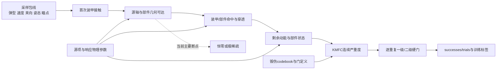

# 毁伤分布稀疏性根因裁决与数据生成整改研究报告

**日期：** 2026-10-23  
**项目：** 巡飞弹撞击装甲车辆的合成毁伤数据生成器  
**研究问题：** 当前毁伤域恒零和极端不均衡究竟是弹型—目标—毁伤定义的必然结果，还是采样、坐标、源项、树定义和数值设计造成的现象？  
**执行环境：** `pytorch312-lmdt`，Python 3.12.13，PyTorch 2.8.0+cu128  
**代码基线：** Git `7c9e088955f1830a7590d016a28eecf0654c0f1d` 加本轮经验证但尚未提交的修改  
**当前引擎身份：** `0.7.0.dev3` / `sha256:8866e874dd6bc306e6c087251312a53d6f6681dbb6c5e7da6fd2bed32412e00a`  
**科研准入：** `research_admission=false`  
**报告性质：** 软件机制辨识、统计可辨识性分析和数据工程验证；不是武器效能鉴定、真实毁伤概率报告或物理标定报告。

---

## 摘要与裁决

本轮证据支持一个不对称的混合结论：

> **当前证据足以否定“该弹型与该目标必然只能产生现有程度的稀疏毁伤”这一单因解释。单一来向/姿态、接触域截断和旧毁伤树已被证明对标签支持有实质性的人为/方法贡献；当前软件中最大的敏感因素是战斗部源轴符号，但在弹体坐标和战斗部物理语义确认前，尚不能把历史 `-body-X` 判为人为错误。目标遮蔽、关键部件投影面积、系统冗余、真实破片场和二级毁伤语义仍可能形成真实长尾。因此，方法因素确有贡献，但人为因素与真实物理因素对最终稀疏性的占比目前不可辨识。**

结论的证据链如下。

1. 历史 5000 例正式归档全部为首次装甲接触，却只有一个速度方向 `[1,0,0]` 和一个姿态 `[0,0,0,1]`。这不是“未命中样本过多”，而是**接触条件下的单来向、单姿态支持截断**。
2. 旧七输出中 K1、K2、C1、C2 为 `0/5000`，F1 为 `28/5000`。旧 M1/M2 又有 `1346/5000` 个严格 `M2>M1` 违例，旧七列不能直接改名为 KMFC 两级。
3. 当前三个 Taylor 破片源以 `-body-X` 为主轴，而机体 `+X` 与飞行速度同向。正式样本从车辆一侧沿 `+X` 接触时，主破片束主要朝来路侧；几何必要条件已经在命中、穿透和树门之前排除了大量内部部件。
4. 最终受控试验使用 6 来向×3 接触点×3 roll×3 弹型×2 源轴、每条件 R=8，共 324 个条件；324/324 均目标朝向、姿态对齐并通过首次装甲接触。162 个源轴对各有独立 aleatory 随机流，轴对内共享随机数。
5. R=8 时，当前 `-body-X` 的 K/M/F/C 上游支持率只有 **8.6%/11.1%/14.8%/7.4%**；诊断用 `+body-X` 为 **72.2%/100.0%/82.7%/99.4%**。严格配对风险差为 **+63.6/+88.9/+67.9/+92.0 个百分点**。这足以反证“固定弹型—目标在软件模型空间内必然同等稀疏”，但不能证明 `+body-X` 是物理正确值。
6. 当前轴下，四个侧向来向的四类支持全部为零；bottom-up 和 top-down 才出现局部支持。来向—接触配置是强因素。Roll 只在 108 组三角比较中的 K/F/C 各 4/6/4 组改变二值支持，远小于源轴影响。
7. R 从 1 增至 8 时，当前轴 K/M/F/C 仅由 5.6/11.1/11.1/6.2% 增至 8.6/11.1/14.8/7.4%。增加重复数会发现少量稀有事件，但不能修复主要几何零。
8. 大弹型显著提高平均部件命中数，但没有在当前轴下单调消除 K/F 稀疏。这说明“战斗部威力太小”可能影响剂量和等级跨阈，却不是当前严格零的充分解释。
9. 对零锚、正阈值的三级教师，若无正支撑比例为 `z`，必有 `P(level=0)>=z`。当前轴 R=8 的 K/M/F/C 距三等分分布的总变差距离下界仍为 **0.580/0.556/0.519/0.593**；只调毁伤树阈值在数学上无法把它们配平。
10. 本轮已经实现多方向接触流形、15 维 learner 输入、拒绝候选不执行教师，以及未标定的 KMFC 有序教师骨架。它们通过软件测试，但物理参数和树阈值仍未获准，因此没有生成大规模“正式训练集”，避免把尚未裁决的源轴偏置扩大。

---

## 1. 问题的可检验形式

本报告中的 KMFC 是项目候选 codebook，而非已获外部认可的通用毁伤标准：K 表示燃油/弹药等关键储能单元，M 表示动力、行走与机动功能，F 表示观瞄、火控、武器及供弹链，C 表示必要乘员与载员功能。四类语义和部件归属仍须在 P1 正式批准。

令类别 \(g\in\{K,M,F,C\}\) 的标签为

\[
Y_g=T_g\!\left(S_\theta(X,\omega)\right),
\]

其中 \(X\sim p_0\) 是弹型、速度、来向、姿态和接触位置，\(\omega\) 是重复级随机量，\(S_\theta\) 是源项、目标几何、装甲/部件响应和代码版本共同决定的仿真链，\(T_g\) 是毁伤树。观测分布

\[
\pi_g^{\mathrm{obs}}=
\mathbb E_{X\sim p_0,\omega}
\left[\mathbf 1\{Y_g>0\}\right]
\]

只对一个冻结元组 `(p0, theta, T, R, code)` 有意义。因此，“项目本身必然稀疏”至少要求低支持对以下改变仍稳健：

- 经批准的攻击包线和接触面；
- 经物理确认的弹体坐标、起爆点和破片主轴；
- 经标定的装甲/部件响应；
- 语义合理且有序的 KMFC 树；
- 足以区分低概率事件与确定零的重复数。

当前项目尚不满足这些前提，所以不能从旧 5000 例的零标签直接推导真实物理零。

### 1.1 四种零必须区分

| 零的类型 | 含义 | 当前判定 |
|---|---|---|
| 归档观测零 | 有限归档中没有正例 | K1/K2/C1/C2 已确认 |
| 当前设计结构零 | 在当前方向、源轴、接触域和模型内不可达或极难达 | K/C 强证据，F 局部支持 |
| 完整软件支持上的数学零 | 对允许域内全部随机量严格不可能 | 尚未证明 |
| 真实物理零 | 真实任务域内不可能发生 | 没有证据支持 |

### 1.2 因果链

若在 C 阶段已经为零，增加样本、加大类别权重、使用 Focal Loss 或降低最终门阈值都不会恢复真实信息。

---

## 2. 证据、版本与推断边界

| 证据 | 身份/规模 | 可支持的结论 | 不能支持的结论 |
|---|---|---|---|
| 历史正式归档 | dev1；5000 例；R=2 | 描述旧输入和旧标签分布 | 与当前 dev3 逐例反事实、真实概率 |
| 当前受控析因 | dev3；324 条件；Rmax=8 | 当前软件内的方向、源轴、roll、弹型和 R 敏感性 | 作战发生率、物理正确轴 |
| 接触流形 smoke | dev3；18 正式例，另 4 拒绝例 | 新数据合同和拒绝路径可执行 | 训练充分性、现实来向分布 |
| KMFC 软件原型 | 合成哨兵和旧归档只读审计 | 零锚、单调、嵌套、缺失传播等数学性质 | 阈值、权重和类别语义的物理正确性 |
| R04/R05 高保真链 | R04 数值拒绝，R05 尚未完成实算准入 | 当前不能用作标定 | 战斗部威力充分或不足的定量结论 |

最终析因结果已通过 `controlled_factorial_validation.json` 的全部合同、账本、聚合、随机种子和代码身份检查。其稳定性区间只是固定诊断网格重采样结果，不是目标任务总体的置信区间。试验只使用一个固定 epistemic 目标实现，也不能量化目标参数不确定性。

---

## 3. 历史正式归档说明了什么

### 3.1 输入边际均匀掩盖了方向支持缺失

旧 5000 例中的三种弹型大致等量，y、z、速度的边际和二维网格覆盖也较均匀，5000/5000 都发生首次装甲接触。但所有案例只有：

- 一个归一化速度方向 `[1,0,0]`；
- 一个符号规范化姿态 `[0,0,0,1]`；
- 两个负 x 首接触平面；
- 同一个未验证的后向 `-body-X` Taylor 主轴族。

所以数据集只回答“在一个单侧、条件接触域内，当前未标定代理会输出什么”。它没有覆盖方向和姿态效应，也不能估计未命中率。用户要求正式样本不得未命中或反向飞行是合理的，但由此得到的估计对象必须明确写成**条件于首次装甲接触**，不能再解释为无条件任务成功率。

### 3.2 旧标签本身不可共同训练

| 旧输出 | 非零例/5000 | 主要问题 |
|---|---:|---|
| `effect-k1` | 0 | 常量，无类别内判别信息 |
| `effect-k2` | 0 | 与 K1 不是同一严重度轴 |
| `effect-m1` | 996 | 与 M2 叶集合不同 |
| `effect-m2` | 1770 | 与 M1 有 1346 个严格顺序违例 |
| `effect-f1` | 28 | 极稀疏且缺少 F2 |
| `effect-c1` | 0 | 常量，人员角色/人数语义未批准 |
| `effect-c2` | 0 | 常量，语义未批准 |

候选 KMFC 组件域的上游正支撑为 K=28、M=2205、F=28、C=0。K/F 的 28 例来自同一狭窄局部通道，说明 codebook 可以改变支持，但不能证明新树已合理。

---

## 4. 本轮已执行的人为因素修复

### 4.1 多方向、目标朝向的接触流形

新增 SamplingSpec `1.4.0` 和 `target-facing-ray-manifold@1.0.0`，联合采样：

1. 六个诊断来向；
2. 接触横向瞄点 `u/v`；
3. 正 standoff；
4. 80–160 m/s 速度；
5. 绕机体 `+X` 的完整 roll。

构造满足：

\[
o=a-d\hat v,\qquad v=s\hat v,\qquad R_{body\to target}[:,0]=\hat v,
\]

即轨迹起点 `o` 位于瞄点 `a` 的反向延长线上，速度指向装甲车，机体 `+X` 与速度同向。形式候选仍必须由 S-CONTACT 重新计算首次装甲交点。未接触、反向或姿态不一致的候选只进入拒绝账本，不执行教师，也不获得零标签。

六个来向是**机制覆盖设计**。其中 bottom-up 等来向可能不属于真实巡飞弹攻击包线，未来必须由获准的 `p0` 决定真实权重。

### 4.2 学习输入不再隐藏被采样自由度

新 archive-native learner 输入为 15 维：

- 弹型 one-hot：3；
- 轨迹起点：3；
- 目标坐标速度：3；
- body-to-target 旋转 6D：6。

旋转 6D 使用旋转矩阵前两列，避免四元数 `q/-q` 双重表示；同一旋转的 `q` 与 `-q` 产生完全相同的输入和身份哈希。Zhou 等对神经网络中旋转表示连续性的分析支持使用 5D/6D 表示而不是直接回归完整姿态空间中的低维不连续表示。[CVPR 2019 官方页面](https://openaccess.thecvf.com/content_CVPR_2019/html/Zhou_On_the_Continuity_of_Rotation_Representations_in_Neural_Networks_CVPR_2019_paper.html)

固定场景身份排除所有采样姿态和派生碰撞字段，学习身份则纳入全部 15 维输入，防止同一物理输入跨 split 或角色重复。

### 4.3 软件验证结果

- 正式 smoke：18 例，六来向各 3 例，18 种姿态，最小 body `+X`/速度余弦为 1.0，全部通过 S-CONTACT，张量形状 `[18,15]`；
- 拒绝 smoke：22 个候选中 18 个正式、4 个 `no_forward_armor_intersection`，4 个拒绝项的 `formal_teacher_executed=false`；
- schema 的 package/root 副本字节一致；SamplingSpec 1.2 伪装 contact-pose 合同的版本绕过已 fail-closed；
- `randomized_lhs` 已严格裁剪至开单位立方体，避免理论上的精确零与流形边界合同冲突；
- SamplingSpec 1.4 当前只支持 reference sampling；adaptive executable rounds 明确拒绝 1.4，未假装已经实现。

该修改解决了“姿态和来向固定、网络看不到变化自由度、拒绝样本可能被当负例”的软件问题。它没有决定战斗部主轴物理方向。

---

## 5. 最终受控析因试验

### 5.1 设计

| 因素 | 水平 |
|---|---|
| 来向—接触配置 | 6 个正交方向 |
| 每面瞄点 | 3 |
| 绕速度轴 roll | 0°、45°、90° |
| 弹型 profile | small、medium、large |
| 源轴 | 历史 `-body-X`、诊断 `+body-X` |
| 条件内重复 | Rmax=8，并读取 R=1/2/4/8 嵌套前缀 |

总计 324 条件、2592 条重复轨迹。162 个不含源轴的候选各使用唯一 aleatory seed；两个源轴条件在同一候选内共享随机数。所有候选均通过首次装甲接触，轴间没有因拒绝造成分母不平衡。

### 5.2 源轴是当前最大的软件敏感因素

| 类别 | 当前轴 R=8 | 诊断轴 R=8 | 严格配对风险差 | `0→1` / `1→0` |
|---|---:|---:|---:|---:|
| K | 8.6% | 72.2% | +0.636 | 110 / 7 |
| M | 11.1% | 100.0% | +0.889 | 144 / 0 |
| F | 14.8% | 82.7% | +0.679 | 110 / 0 |
| C | 7.4% | 99.4% | +0.920 | 149 / 0 |

固定诊断网格配对稳定性区间分别为 K `[0.549,0.716]`、M `[0.840,0.932]`、F `[0.605,0.747]`、C `[0.877,0.957]`。这些区间只描述当前规则网格，不是作战总体置信区间。

正确解释是：

- 当前软件输出对源轴/坐标定义高度敏感；
- 极端稀疏不是该固定弹型和目标在软件模型空间中的不可变结果；
- `+body-X` 只是反事实干预，尚不能写回正式 registry；
- K 有 7 个 `1→0`，所以翻轴也不是对每个工况单调改善。

### 5.3 来向—接触配置是第二个强因素

当前轴下，front/rear/left/right 四个侧向来向的 K/M/F/C 支持全部为零；bottom-up 的 K/M/F/C 为 51.9/66.7/51.9/11.1%，top-down 为 0/0/37.0/33.3%。诊断轴下 M 在六面均为 100%，K/F 仍随面变化。

这里的 `face` 同时改变来向、瞄点坐标系、实际首接触装甲和法向，因此应称为“来向—接触配置效应”，不能拆成纯方向因果效应。它仍足以证明旧单 `+X` 设计不能识别其他接触配置。

### 5.4 Roll 是次要但非零因素

在 108 组完整 roll 三联组中，K/M/F/C 的二值支持分歧组数为 4/0/6/4。三个 roll 水平下的源轴风险差跨度只有约 0.019/0/0.019/0.019。结论限于当前 0°/45°/90°、有限破片实现和固定网格；不能外推完整连续 roll 或真实破片场。

### 5.5 增加 R 只能发现少量额外事件

| 源轴 | R | K | M | F | C |
|---|---:|---:|---:|---:|---:|
| 当前轴 | 1 | 5.6% | 11.1% | 11.1% | 6.2% |
| 当前轴 | 8 | 8.6% | 11.1% | 14.8% | 7.4% |
| 诊断轴 | 1 | 71.0% | 100.0% | 81.5% | 98.1% |
| 诊断轴 | 8 | 72.2% | 100.0% | 82.7% | 99.4% |

R 前缀的 `ever-positive` 按定义只能从 0 变 1，验证中没有非法 `1→0`。R≤8 尚未证明概率低于 1/8 的机制不存在，但已经说明重复数不是当前四类大面积零支持的主要修复手段。

### 5.6 弹型/威力不是一个单变量

当前轴 small/medium/large 的平均部件命中为 18.92/47.76/95.58，诊断轴为 87.71/229.37/472.33，说明更大 profile 显著提高剂量机会。但当前轴下 large 的 K/F 支持反而只有 3.7/9.3%，低于 small 的 11.1/18.5%。

三个 profile 同时改变破片数、质量、初速、几何和角分布，不能把差异归因于一个“威力”标量。现有结果只能得出：

- 增大源强能够改变命中数和严重度；
- 它不能系统性克服方向相反或几何不可达；
- 是否“战斗部过小”必须在源轴和接触域获准后，用破片数、质量、初速、锥角分别受控的响应面试验回答。

---

## 6. 毁伤树有效性与可优化范围

### 6.1 旧七输出不能作为新八输出

新目标是四类各 0/1/2 级，等价于八个累计事件 `K>=1`、`K>=2`、…、`C>=2`。旧定义缺 F2；K1/K2 来自不同组件；M1/M2 组件集合不同且有 1346 个顺序违例；C 只有 degraded/failed 的形式兼容，人员角色、数量、冗余和时间窗没有批准。

因此必须重新生成新标签，不能重命名、排序或裁剪旧列。

### 6.2 已实现的候选骨架

新原型采用：

\[
u(x;s)=\frac{x}{x+s},\quad u(0;s)=0,
\]

再用正权幂平均形成类别严重度 `S`。每个重复内部执行最终硬门：

\[
B_{1,r}=A_{1,r}\mathbf 1(S_r\ge\tau_1),
\]

\[
B_{2,r}=B_{1,r}A_{2,r}\mathbf 1(S_r\ge\tau_2),
\qquad 0<\tau_1<\tau_2,
\]

从结构上保证 `level2 => level1`。随后聚合 `successes_ge1/trials`、`successes_ge2/trials` 和互斥 `n0/n1/n2`。缺失必需证据产生 unavailable/`null`，已知门为假才是有效等级 0。

当前配置中的尺度 0.25、幂平均阶数 2、阈值 0.30/0.65 都是软件哨兵，不是拟合或物理结果。原型状态固定为 `project_specific/software_only/prototype_not_admitted`。

### 6.3 能量语义不能混用

归档 `deposited_energy_j` 是穿透前后动能损失；当前组件状态律使用穿透后剩余动能。二者不能改名复用。候选教师只接受明确的状态严重度、批准的分支严重度或 `component_residual_kinetic_energy_j`，并拒绝将 penetration loss 冒充 residual energy。

---

## 7. 仅调树阈值为何无法配平

若教师零锚且一级阈值为正，则所有无正支撑案例必属于等级 0。令无正支撑比例为 `z`，则

\[
P(L=0)\ge z.
\]

要实现 0/1/2 精确三等分，必要条件是 `z<=1/3`；当 `z>1/3` 时，到均匀分布的总变差距离至少为 `z-1/3`。

| 数据/条件（R=8） | K 最小 TV | M 最小 TV | F 最小 TV | C 最小 TV |
|---|---:|---:|---:|---:|
| 旧 5000 例 | 0.661 | 0.226 | 0.661 | 0.667 |
| 当前轴多方向诊断 | 0.580 | 0.556 | 0.519 | 0.593 |
| 诊断轴多方向诊断 | 0 | 0 | 0 | 0 |

诊断轴通过的只是必要条件，不证明存在稳定、物理合理的阈值。当前支撑审计使用候选组件的 `deposited_energy_j>0` 和 case-level R 前缀；正式树若改用状态或剩余动能，必须按实际教师证据重新计算该界。

这给出一个明确决策：**先恢复和批准上游支持，再拟合树；不能用非零截距、epsilon 底噪、把 unavailable 填成 0 或把阈值降到无意义区间来制造均衡。**

---

## 8. 因素归因矩阵

| 因素 | 属性 | 当前证据 | 当前裁决 |
|---|---|---|---|
| 单来向/单姿态 | 人为采样设计 | 5000 例唯一方向姿态；多面试验显著改支持 | 已证实近因 |
| 首次接触条件 | 用户规定的估计对象 | 全部正式样本接触；拒绝不标注 | 合理，但只能估计条件毁伤 |
| `-body-X` 源轴 | 可能是人为坐标错误，也可能是真实战斗部属性 | 轴翻转使支持增加 63.6–92.0 个百分点 | 一阶未裁决因素；不得直接改生产值 |
| 接触面/目标遮蔽 | 目标几何与采样共同决定 | 四侧面在当前轴全零，面间差异大 | 混合因素；需获准攻击包线 |
| 弹型 profile | 物理参数包 + 人为建模包 | 命中数随尺寸增，二值支持不单调 | 影响剂量，非严格零首因 |
| 旧毁伤树 | 人为任务定义 | 当前轴 R=8 诊断中 K/F 上游有支持而旧 K1/F1 为零；历史归档 F1 仅 28/5000；M 非有序 | 已证实近因 |
| R=2 | 数值设计 | R=1→8 仅少量新增 | 放大稀疏，不是首因 |
| 装甲/部件响应 | 物理代理参数 | 未外部标定，高保真链未准入 | 影响未知 |
| 目标冗余和关键部件面积 | 项目内生物理 | 结构上合理，但当前未独立量化 | 剩余长尾候选 |

如果 CAD、弹体坐标和高保真证据最终确认 `-body-X` 正确，而且获准攻击包线又主要落在当前无支持面，则“该武器—目标配对在此代理下天然稀疏”会得到支持。当前证据尚未达到这一条件。

---

## 9. 可证伪的物理剩余因素辨识计划

### 9.1 先裁决源轴与坐标

1. 冻结并图示 target frame、body frame、机体前向、速度方向、起爆点、装药轴和 Taylor 角正方向；
2. 用 CAD/原始模型/战斗部设计记录给出 `+body-X` 与 `-body-X` 的物理含义；
3. 建立最小射线哨兵：单一轴向碎片、单一侧向碎片和已知装甲/组件，验证旋转和镜像；
4. 只在物理可接受的连续轴偏角集合内做响应面，不把不物理候选当训练增强；
5. 等 R05 产生可用且数值合格的真实 D3PART/捕获账本后，再比较主束方向、残速和破片场；R04 的负体积失败不能用于标定。

**停止条件：** 弹体前向轴、源轴和起爆参考仍有歧义时，不生成新的大规模正式数据，也不拟合 KMFC 阈值。

### 9.2 单独辨识战斗部强度

在同一获准方向样本和相同随机 block 下，分别改变：

- 有效破片数；
- 单片质量/质量分布；
- Gurney 初速或批准的残速分布；
- Taylor 锥角、展宽和轴偏角；
- 起爆位置/偏心；
- 装甲穿透与组件响应参数。

逐阶段记录 `reachable → hit → penetrate → residual-energy/state → level1 → level2` 的 successes/trials。只有当 hit/penetrate 有支持而后级长期为零时，才把“威力不足或阈值过高”列为主因。

### 9.3 覆盖 epistemic 不确定性

当前只有一个目标参数实现。后续应在多个目标/响应 realization 和多个独立 aleatory block 上做层级设计，使用分层 logistic、binomial 或 beta-binomial 模型估计主效应与交互。随机 block、外层候选和目标 realization 必须分别记账，不能把重复轨迹当独立样本。

---

## 10. 下一版数据集设计

### 10.1 四条数据流必须分开

| 数据流 | 采样分布 | 用途 | 能否报告自然发生率 |
|---|---|---|---|
| `Reference Train` | 经批准并冻结的 `p0` | 基准拟合和参考风险 | 可以，需正确设计权重 |
| `Tree-design fit/holdout` | 输出盲的机制分层设计 | 选择/验证树结构与阈值 | 不可以 |
| `Mechanism-enriched Train` | 可追溯 proposal `q` | 补充稀有机制和等级边界 | 不可以；机制不变时可带权回估 |
| 新密封 `Reference Test` | 冻结 `p0`，全程不可见 | 一次性最终评价 | 可以 |

旧 Test 已被多轮诊断观察，不能继续承担最终确认性测试。

### 10.2 “全面和较均匀”应是训练设计目标

项目专用树和富集 Train 可以追求等级覆盖，但 Reference/Val/Test 应忠实反映获准 `p0`。训练分布更均匀不等于真实毁伤发生率更均匀。

推荐流程：

1. 在 `p0` 中保留防御性混合分量；
2. 用来向、接触区、弹型和预标签几何可达性建立富集 proposal；
3. 保存 `sampling_stream`、`p0`/proposal 定义、选择概率或可复算规则、raw design weight；
4. design weight、任务 loss weight、minibatch 抽样概率使用不同字段；
5. outcome-adaptive 样本只能进入 Train，不能改变 Val/Test；
6. 改变源轴、响应参数或树会改变 `p(y|x)`，必须生成新版本 Reference，不能用重要性权重把旧标签机制校正成新机制。

Au 与 Beck 的 subset simulation 可用于真实存在的稀有事件链；Owen 与 Zhou 的防御性多 proposal 思路可降低重要抽样风险；Sugiyama 等的 IWCV 只在 `p(y|x)` 不变的协变量偏移条件下成立。这些方法都不能从错误物理或零支持中创造正例。

### 10.3 样本量按精度和有效样本量设计

不要先规定一个任意总 N。对每个类别/等级/关键子域预注册允许区间半宽，再按独立外层 case 的 Wilson/层级模型精度决定样本量，并按权重变异和组内相关膨胀。比如独立二项比例在最保守 `p=0.5` 下达到约 ±5 个百分点通常需要约 385 个有效试验；这只是起点，不能把同一 case 的 R 条轨迹计作 R 个独立试验。

若某一级在获准域内仍无法达到预注册的最小有效正例数，应返回 `coverage_unreachable`，而不是继续降低阈值。

---

## 11. 与深度学习衔接

### 11.1 输出头

K/M/F/C 可以同时成立，类别之间不能用 softmax。每类使用两个累计有序输出：

\[
\hat q_{g,1}=\sigma(a_g),\qquad
\hat q_{g,2}=\hat q_{g,1}\sigma(b_g),
\]

从结构上保证 `q2<=q1`。互斥三级概率为

\[
p_{g,0}=1-q_{g,1},\quad
p_{g,1}=q_{g,1}-q_{g,2},\quad
p_{g,2}=q_{g,2}.
\]

CORAL 类有序方法说明共享/受约束累计子任务可以保证 rank consistency，但它不会替项目验证等级语义。[Cao 等](https://arxiv.org/abs/1901.07884)

### 11.2 损失与不确定性

- 保存每类每级 `successes/trials`，优先使用 binomial NLL；若存在额外离散，比较 beta-binomial；
- 若使用 soft BCE，两个累计等级必须共享同一有效分母；
- unavailable 通过类别级 mask 排除，不得填 0；
- 可比较两阶段模型：先预测可达/正支撑，再预测条件严重度；
- 结构化辅助任务可包括几何可达、命中、穿透和组件状态，但这些只能作为教师目标，不能作为部署时不可得的输入。

### 11.3 划分与泄漏防护

- 同一外层候选、同一 trajectory group 和其全部 R 重复必须在同一 split；
- tree-design fit/holdout、model validation 和 sealed Test 的身份分离；
- 所有树、LabelSpec、registry、target、source-axis、sampling spec、训练视图和代码均保存内容哈希；
- 输入归一化只在 Train 拟合；
- 接触面、标签、组件命中、穿透、树输出和采样角色不得作为隐藏捷径输入。

### 11.4 评价

每类报告 prevalence、successes/trials、有效样本量、PR-AUC、precision/recall、Brier、log loss、可靠性和校准斜率；三级有序任务报告 Ranked Probability Score、等级混淆矩阵和 `q2>q1` 违规率。按弹型、来向、接触配置和空间格分层。强不均衡下 PR 图比 ROC 图更直接，但富集 Train 上的 AUPRC 不能代替 `p0` Test 性能。[Saito 与 Rehmsmeier](https://doi.org/10.1371/journal.pone.0118432)

Class-balanced loss 只应在可信正支持已经存在后作为基线；它不能修复常量标签或错误源轴。[Cui 等](https://openaccess.thecvf.com/content_CVPR_2019/html/Cui_Class-Balanced_Loss_Based_on_Effective_Number_of_Samples_CVPR_2019_paper.html)

---

## 12. 准入门与执行顺序

### P0：坐标和物理语义

- [ ] body/target/velocity/warhead 轴定义获得证据和审批；
- [ ] R05 或其他高保真/实测证据数值合格；
- [ ] 装甲、组件和能量语义冻结；
- [ ] 获准攻击包线 `p0` 冻结。

### P1：树设计

- [ ] KMFC codebook、功能分支、必要门和时间窗批准；
- [ ] `tree_design_fit` 只用于选尺度/权重/阈值；
- [ ] `tree_design_holdout` 验证零锚、单调、嵌套、子域稳定和阈值扰动；
- [ ] 真实教师证据上的零支撑界重新计算；
- [ ] K/F/C 若不可达则显式失败，不制造伪标签。

### P2：数据与模型

- [x] 正式样本必须目标朝向并通过 S-CONTACT；
- [x] 未命中/反向候选不执行教师、不写零标签；
- [x] 所有变化姿态与方向进入 learner 输入；
- [ ] Reference、富集 Train、tree-design 和 sealed Test 分轨冻结；
- [ ] 多 epistemic realization 和 R 收敛通过；
- [ ] 概率、校准、有序和子域指标通过预注册阈值。

在 P0/P1 未完成前，保持 `research_admission=false`。

---

## 13. 验证、复现与空间管理

### 13.1 关键机器证据

- `review_evidence/human_factor_remediation_20261022/controlled_factorial_diagnostic.json`
- `review_evidence/human_factor_remediation_20261022/controlled_factorial_validation.json`
- `review_evidence/human_factor_remediation_20261022/candidate_ledger.jsonl`
- `review_evidence/human_factor_remediation_20261022/zero_anchor_balance_feasibility.json`
- `review_evidence/human_factor_remediation_20261022/damage_tree_validity_and_software_prototype_audit.json`
- `review_evidence/contact_pose_sampling_20261023/verification_summary.json`
- `review_evidence/contact_pose_sampling_20261023/smoke_archive/`
- `review_evidence/contact_pose_sampling_20261023/rejection_checkpoint/`
- `review_evidence/human_factor_remediation_20261022/final_research_report_validation.json`
- `review_evidence/human_factor_remediation_20261022/pytest_full_final_20261023.xml`

### 13.2 测试状态

- 基线定向测试：78 passed；
- KMFC 原型定向测试：51 passed；
- 接触流形定向/兼容测试：47 passed，已覆盖 LHS 开区间边界测试；
- 独立集成审查：98+58 项通过，2000 姿态性质检查的最大误差低于 `1.8e-15`；
- 当前源码最终全量测试：892 passed，0 failed，0 error，0 skipped（77.454 s）；JUnit 记录为 `review_evidence/human_factor_remediation_20261022/pytest_full_final_20261023.xml`；
- `git diff --check`：仅已有的 LF/CRLF 转换提示，无空白错误。

### 13.3 空间管理

最终析因持久证据约 3.70 MB；18 例 smoke 与拒绝账本保持小规模。本轮 pytest 隔离产物约 79.81 MiB，全部位于工作区 `.tmp`；递归清理命令被运行环境自动审批拒绝，因此未绕过机制删除。D 盘仍有约 171.39 GiB 可用空间，该临时占用不影响后续试验。历史 5000 例归档、R04/R05 证据、历史报告和用户已有未提交文件均保留。由于源轴和物理响应尚未裁决，本轮没有盲目生成大规模正式归档；这比扩大一个已知偏置的数据集更符合科研可追溯性。

---

## 14. 限制

1. 当前软件和响应参数未外部标定；结果不能解释为真实毁伤概率。
2. 诊断网格平衡且固定，不代表作战来向分布。
3. 全部正式样本条件于首次装甲接触，不能估计未命中率。
4. 只有一个 target/epistemic realization。
5. 析因速度固定 120 m/s；新采样合同虽支持 80–160 m/s，但交互尚未量化。
6. 只有三个 roll 角、每面三个瞄点和两个源轴符号。
7. 未考察连续轴偏角、偏心/多点起爆和真实破片列表。
8. R≤8，不能排除更低概率机制。
9. 当前正支撑以候选组件能量损失为诊断代理，不是新树的最终证据模型。
10. 旧 Test 已被观察；未来最终模型必须使用新密封 Test。
11. 接触流形和 KMFC 原型的软件通过不等于物理有效或科研准入。

---

## 15. 最终结论

对用户提出的二择问题，当前最严谨的回答不是“完全由项目性质决定”，也不是“物理因素完全无关”。证据支持以下分层裁决：

1. **“项目性质必然导致现有程度的稀疏”没有成立；方法因素已被证明有实质贡献。** 单来向、单姿态、来向—接触支持截断和旧树任务定义会压缩或改写支持；最大的源轴效应已被定量确认，但其究竟是坐标错误还是战斗部真实后向特性仍待物理裁决。因此当前不能严谨地给出“人为因素占主要比例”的最终归因百分比。
2. **战斗部尺寸不是当前严格零的首因。** 大 profile 提高命中数，却不能克服错误方向和几何不可达；威力仍会影响一级/二级跨阈，需要在轴语义获准后单独标定。
3. **毁伤树可以为本项目特化，但不能通过伪标签实现均衡。** 零锚平滑证据加逐重复有序硬门在软件上可行；阈值必须在独立 tree-design 数据上选择。当前轴下的零支撑比例已经数学上排除仅靠阈值实现近似三等分。
4. **残余的项目内生长尾仍可能存在，但尚未测量。** 它可能来自关键部件面积、遮蔽、装甲、冗余、真实破片场和严重等级语义。只有在坐标、物理、树和 `p0` 获准后仍稳定稀疏，才可归为项目本性。
5. **面向神经网络的正确目标是双轨数据，而不是把所有分布强行做平。** Reference 保留真实 `p0`，富集 Train 提供机制和等级覆盖；模型采用 15 维完整姿态输入、四类累计有序头、availability mask 和 successes/trials。最终泛化与校准只在新密封 Reference Test 上评价。

本轮已经把最关键的人为采样缺陷修复到可执行、可审计状态，并给出了源轴、接触配置、R、弹型和树定义的定量相对证据。下一项决定性工作不是继续扩大旧分布，而是完成 `P0` 的弹体/源轴物理裁决和高保真数值准入；在此之前维持 `research_admission=false` 是必要且有证据支持的决定。

---

## 参考文献

1. Au, S.-K., & Beck, J. L. (2001). Estimation of small failure probabilities in high dimensions by subset simulation. *Probabilistic Engineering Mechanics, 16*(4), 263–277. [DOI](https://doi.org/10.1016/S0266-8920(01)00019-4).
2. Owen, A., & Zhou, Y. (2000). Safe and effective importance sampling. *Journal of the American Statistical Association, 95*(449), 135–143. [DOI](https://doi.org/10.1080/01621459.2000.10473909).
3. Sugiyama, M., Krauledat, M., & Müller, K.-R. (2007). Covariate shift adaptation by importance weighted cross validation. *JMLR, 8*, 985–1005. [JMLR](https://www.jmlr.org/papers/v8/sugiyama07a.html).
4. Cui, Y., Jia, M., Lin, T.-Y., Song, Y., & Belongie, S. (2019). Class-balanced loss based on effective number of samples. *CVPR*. [CVF](https://openaccess.thecvf.com/content_CVPR_2019/html/Cui_Class-Balanced_Loss_Based_on_Effective_Number_of_Samples_CVPR_2019_paper.html).
5. Saito, T., & Rehmsmeier, M. (2015). The precision-recall plot is more informative than the ROC plot when evaluating binary classifiers on imbalanced datasets. *PLOS ONE, 10*(3), e0118432. [DOI](https://doi.org/10.1371/journal.pone.0118432).
6. Cao, W., Mirjalili, V., & Raschka, S. (2020). Rank consistent ordinal regression for neural networks with application to age estimation. *Pattern Recognition Letters, 140*, 325–331. [arXiv](https://arxiv.org/abs/1901.07884).
7. Zhou, Y., Barnes, C., Lu, J., Yang, J., & Li, H. (2019). On the Continuity of Rotation Representations in Neural Networks. *CVPR*, 5745–5753. [CVF](https://openaccess.thecvf.com/content_CVPR_2019/html/Zhou_On_the_Continuity_of_Rotation_Representations_in_Neural_Networks_CVPR_2019_paper.html).
8. Mullahy, J. (1986). Specification and testing of some modified count data models. *Journal of Econometrics, 33*(3), 341–365. [DOI](https://doi.org/10.1016/0304-4076(86)90002-3).
9. Sobol', I. M. (2001). Global sensitivity indices for nonlinear mathematical models and their Monte Carlo estimates. *Mathematics and Computers in Simulation, 55*(1–3), 271–280. [DOI](https://doi.org/10.1016/S0378-4754(00)00270-6).
10. Newcombe, R. G. (1998). Two-sided confidence intervals for the single proportion: comparison of seven methods. *Statistics in Medicine, 17*(8), 857–872. [DOI](https://doi.org/10.1002/%28SICI%291097-0258%2819980430%2917%3A8%3C857%3A%3AAID-SIM777%3E3.0.CO%3B2-E).

