# 系统架构

## 1. 设计目标

Damage Dataset Engine 将一个冻结案例转换为可追溯的合成毁伤响应，并把外层工况、随机重复、域状态、标签可用性和训练输入分别记录。架构围绕三个原则组织：

1. 物理事件按绝对到达时间推进；
2. 采样身份、案例身份、学习输入身份和随机重复身份分离；
3. 不可解析事件以状态和边界传播，不改写成零响应。

## 2. 主计算链

```mermaid
flowchart LR
    A[Case + Target + Registry] --> B[输入校验与内容哈希]
    B --> C[接触与起爆几何]
    C --> D[破片源与冲击波源]
    D --> E[全局事件时间线]
    E --> F[装甲相交与分层侵彻]
    F --> G[孔洞和装甲状态]
    G --> H[部件命中与空间累积毁伤]
    H --> I[机理合成与毁伤树]
    I --> J[重复级结果与在线统计]
    J --> K[归档、训练视图与审计]
```

### 输入层

- `simulation_case.schema.json`：相遇条件、战斗部、环境、分析预算和评价请求。
- `target.schema.json`：装甲、部件、几何、响应参数和毁伤树。
- `physics_registry.schema.json`：由包内注册表加载的物理模型与适用域。
- `sampling_spec.schema.json`：设计分布、流角色、重复预算、切分和采样质量门。
- `label_spec.schema.json`：标签任务、可用性、聚合和训练用途。

所有长度、速度、质量、时间和能量在运行时使用 SI。内容哈希绑定规范化后的输入，而不是文件名或绝对路径。

### 事件层

`damage_engine.engine` 协调破片与冲击波机制。破片路径由全局下一事件堆推进；每枚破片只提交自己的下一次接触，事件按绝对时间排序。穿孔完成时间包含逐层材料传输时间。孔洞状态可按历史时刻查询，因此早到破片、冲击波波前和后到破片看到一致的时间切片。

冲击波峰值使用波前到达时的局部孔洞状态，冲量对正相位内的孔洞事件分段积分。本脉冲造成的装甲失效在正相位结束后生效，随后影响后到破片。

### 响应层

- `penetration.py`：单层侵彻和残速关系。
- `layered_penetration.py`：相邻同材质层合并、逐层速度和传输时间。
- `panel_damage.py`：穿孔历史、解析圆并集、连通开口和完整度。
- `component_damage.py`：命中空间聚类、簇内能量累积和部件状态。
- `mechanism_coupling.py`：破片与冲击波的依赖边界和敏感性点估计。
- `damage_tree.py`：版本化树、评价视图和依赖情景。
- `kmfc_ordinal_teacher.py`、`ordinal_projection.py`：显式调用的有序软件教师原型。

部件联合响应同时保存 Fréchet 下界、上界和声明情景。毁伤树依赖场景只有在叶事件结构允许时才输出数值；冲突场景返回 `unavailable` 和冲突明细。

## 3. 采样与身份

### 四类身份

| 身份 | 用途 | 典型内容 |
|---|---|---|
| 设计身份 | 判断采样行是否相同 | SamplingSpec、候选坐标、流角色、轮次 |
| 案例身份 | 复现一次确定性外层输入 | target/case/registry 内容哈希 |
| 学习输入身份 | 防止相同模型输入跨 split | 训练视图中的完整特征与上下文 |
| 重复身份 | 产生稳定随机流 | 案例、参数实现、replicate、物理事件键 |

随机流由重复时间线和物理事件键派生。无关破片的插入、删除或重排不改变既有事件抽样；物理上相同的匿名破片通过稳定组内序号获得不同随机流。

### 接触流形

SamplingSpec 1.4 使用 `target-facing-ray-manifold@1.0.0` 联合生成：

- 来向；
- 装甲面内瞄点；
- 正 standoff；
- 撞击速度；
- 绕机体前向轴的 roll。

轨迹起点、速度和姿态由同一潜变量向量生成。正式候选再通过 S-CONTACT 复算首次装甲交点。未接触或合同不一致的候选进入拒绝账本，教师不执行。

## 4. 数据与训练层

`dataset.py`、`sharded_dataset.py` 和 `archive_validation.py` 负责生成、分片、提交清单和严格读取。`training_view.py` 将归档原生输入转换为模型特征；接触姿态任务使用三型 one-hot、位置、速度和旋转 6D，共15维。`torch_dataset.py` 提供批量读取接口。

`online_statistics.py` 在不保留全部重复轨迹时维护充分统计量。开启 raw replicate trace 可支持随机重复收敛研究，两种模式必须产生相同科学摘要。

## 5. 采样优化层

- `fast_sampling_proxy.py`：计算候选的几何/覆盖代理。
- `sampling_risk_model.py`：估计完整响应域和条件饱和风险。
- `normalized_sampling.py`：生成分层参考臂和覆盖增强臂。
- `adaptive_sampling.py`：管理 proposal、选择概率和轮次账本。
- `sampling_checkpoint.py`：冻结计划、候选、提交集合和恢复状态。

代理用于候选排序和预算分配。软件教师结果仍是训练标签与最终方法比较的依据。

## 6. 适用域与状态传播

超出侵彻倾角适用域的接触标记为 `obliquity_out_of_domain`，终止该破片路径并传播到重复级完成状态。L1/L2 结果包含删失比例和最坏情形概率界；L3 遇到未解析侵彻事件时拒算。错误入射侧属于几何不变量错误，直接抛出异常。

参数、模型和标签语义通过注册表状态进入数据合同。当前目标参数仍为 `unverified`，因此数据产物的用途由 dataset policy 和 manifest 明确限定为软件与数据方法开发。

## 7. 模块导航

| 主题 | 入口 |
|---|---|
| 引擎编排 | `damage_engine/engine.py` |
| 几何与接触 | `geometry.py`、`impact.py`、`contact_contract.py` |
| 破片与侵彻 | `fragments.py`、`penetration.py`、`layered_penetration.py` |
| 冲击波 | `blast.py` |
| 组件与树 | `component_damage.py`、`damage_tree.py` |
| 采样 | `sampling_spec.py`、`contact_manifold_sampling.py`、`adaptive_sampling.py` |
| 数据归档 | `dataset.py`、`sharded_dataset.py`、`archive_validation.py` |
| 训练接口 | `training_view.py`、`torch_dataset.py`、`system_learning.py` |
| 质量与验证 | `quality.py`、`scientific_validation.py`、`model_coverage.py` |
