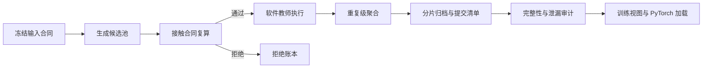

# 数据管线

## 1. 管线目标

数据管线把版本化的案例、目标、模型注册表与采样设计转换为可复现的训练数据。每条记录同时保存输入身份、设计来源、选择概率、教师状态、标签可用性和切分归属，使采样比较、统计估计与模型训练可以沿同一条证据链复核。

## 2. 输入合同

| 合同 | 作用 | 稳定入口 |
|---|---|---|
| Simulation Case | 相遇条件、战斗部、环境、计算预算 | `schemas/simulation_case.schema.json` |
| Target | 装甲、部件、响应参数、毁伤树 | `schemas/target.schema.json` |
| Physics Registry | 模型实现、适用域与验证状态 | `damage_engine/registry.py` |
| SamplingSpec | 参考分布、流角色、预算、种子、切分与质量门 | `schemas/sampling_spec.schema.json` |
| LabelSpec | 输出任务、聚合方式和可用性 | `schemas/label_spec.schema.json` |
| Dataset Manifest | 文件哈希、轴语义、身份、来源和提交状态 | `damage_engine/dataset.py`、`damage_engine/sharded_dataset.py` |
| Dataset Policy | 已验证快照、用途和加载约束 | `damage_engine/dataset_policy.py` |

Schema 源文件位于 `schemas/`，包内镜像位于 `damage_engine/schemas/`。两处内容必须逐字节同步。运行时量统一使用 SI；显示单位不进入训练合同。

## 3. 候选生成与接触准入

### 3.1 联合采样

SamplingSpec 1.4 的接触姿态合同为 `loitering_impact_contact_pose@1.0.0`，流形实现为 `target-facing-ray-manifold@1.0.0`。一个潜变量向量联合决定：

- 弹型；
- 目标坐标系中的来向和面内瞄点；
- 正 standoff；
- 撞击速度；
- 绕弹体前向轴的 roll；
- 与来向一致的轨迹起点、速度和姿态。

联合生成避免位置、速度和姿态分别抽样后产生反向飞行或几何不一致。`approach_weight` 表示声明的设计质量，不表示实际来袭概率、命中率或作战频率。

### 3.2 S-CONTACT 准入

每个正式候选在执行教师前重新求解首次正向装甲交点。准入条件包括：

1. 原点位于目标外部；
2. 速度有限且非零；
3. 轨迹沿正向射线到达装甲；
4. 首次接触板、距离、时间和命中点与持久化字段一致；
5. 弹体前向轴与速度方向满足姿态合同。

未命中、反向轨迹、零速度、目标内部起点和陈旧接触字段写入拒绝账本。拒绝记录属于采样审计，不进入响应标签轴，也不以零毁伤替代。

## 4. 教师执行与状态传播

准入样本进入 [系统架构](ARCHITECTURE.md) 所述事件链。每个外层候选可配置多个随机重复；重复使用由案例、参数实现、重复序号和物理事件键派生的稳定随机流。

教师输出分成三类：

| 状态 | 含义 | 数据处理 |
|---|---|---|
| `complete` | 请求的响应可在声明适用域内计算 | 保存有限标签，`response_mask=true` |
| `domain_censored` | 至少一个必要物理事件超出当前软件教师适用域 | 响应张量保存 `NaN`，`response_mask=false` |
| `refused` | 输入或接触合同失败，教师未执行 | 仅写拒绝/选择账本 |

部分响应只有在 LabelSpec 显式定义逐任务掩码时才能进入训练。缺少该合同的标签按整行不可用处理。

## 5. 归档与提交

### 5.1 归档形式

- JSONL/JSONL.GZ：案例、结果、选择和拒绝账本；
- Parquet：案例、装甲、部件、树输出、边和切分等关系表；
- NPZ：定长训练张量、掩码、权重与轴名；
- JSON：manifest、checkpoint、schema 和验证报告。

单体归档适合小规模诊断；分片归档用于批量生成。分片写入采用临时目录、原子提交、根清单和内容哈希。恢复运行只复用已重新验证的分片；输入、代码、环境或依赖快照漂移会拒绝续跑。

### 5.2 身份与去重

管线分别维护：

- `design_id`：候选在采样设计中的身份；
- `case_id`：规范化案例与依赖内容的身份；
- `candidate_group_id`：同一学习输入的分组身份；
- `realization_key`：随机重复身份；
- `dataset_id`：逻辑数据集身份，与分片布局分离。

同一候选可被多个采样臂选中，因此选择观测数可以大于唯一候选数。训练视图按 `candidate_group_id` 去重，源臂成员关系和选择概率保存在独立账本中。

## 6. 切分治理

Reference、覆盖增强和验证流承担不同职责：

| 流 | 主要用途 | 统计规则 |
|---|---|---|
| Reference | 估计声明参考分布下的发生率、校准与外推风险 | 保留原始设计概率和设计权重 |
| Coverage | 增加过渡区、稀有部件和非饱和标签覆盖 | 作为训练增强；不得替代 Reference 发生率 |
| Validation | 选择完成后的独立开发评估 | 不参与归一化、代理拟合或超参数选择 |

切分按候选组与设计种子完成。同一 `candidate_group_id` 不得跨 train/validation；随机重复也不得拆到不同切分。当前开发数据包没有密封 test，正式模型评价需要另建冻结 test 设计。

## 7. 训练视图

### 7.1 15 维学习输入

`loitering_impact_contact_pose@1.0.0` 使用：

- 弹型 one-hot：3 维；
- 目标坐标系轨迹起点：3 维；
- 目标坐标系速度：3 维；
- 弹体到目标旋转矩阵前两列的连续 6D 表示：6 维。

总计 15 维。四元数符号不会改变旋转 6D 表示。`x_design` 也有 15 维，但它保存采样坐标，仅用于采样诊断或显式声明的辅助输入；默认学习输入为 `x`。

### 7.2 标签与掩码

当前开发数据包保存：

- 67 个部件的支持、命中数、侵彻数、沉积能量和严重度；
- 7 个毁伤树输出；
- 正支持部件数、总命中、总侵彻、总沉积能量和教师严重度等摘要；
- 完整域标志、响应掩码、切分、设计权重和来源成员关系。

完整域样本的响应为有限值；域删失样本的响应为 `NaN`。训练代码必须在损失计算前使用掩码，禁止通过 `nan_to_num` 把不可用标签变成负例。

### 7.3 归一化

`x_train_mean` 和 `x_train_scale` 只由 train 切分拟合。常量特征保持可识别的常量状态，不用人为 epsilon 伪造方差。validation 和后续 test 使用冻结的 train 统计量。

## 8. 当前开发数据包

稳定入口为 `artifacts/development_dataset/`：

| 项目 | 数值 |
|---|---:|
| 源臂 | 8 个，每臂 2,000 条选择观测 |
| 选择观测 | 16,000 |
| 唯一候选 | 10,589 |
| 完整域标签 | 7,337 |
| 域删失 | 3,252 |
| Train | 7,965 |
| Validation | 2,624 |
| 密封 Test | 无 |

`dataset_manifest.json` 记录来源臂、内容哈希、质量检查和数据角色；`validation_report.json` 记录独立重算式验收。数据包状态为 `development_ready`。

## 9. 管线验收清单

- 输入、Schema、代码和依赖身份完整；
- 所有正式样本满足接触合同；
- 拒绝、域删失和真实零响应分开记录；
- 原始设计概率、设计权重、任务损失权重和小批量概率分轴保存；
- 相同候选与重复组不跨切分；
- 归一化仅拟合 train；
- manifest 中的文件哈希与实际字节一致；
- 训练加载器重新验证已提交归档；
- Reference 与 Coverage 分账报告；
- test 在模型与训练规则冻结后单独生成。
