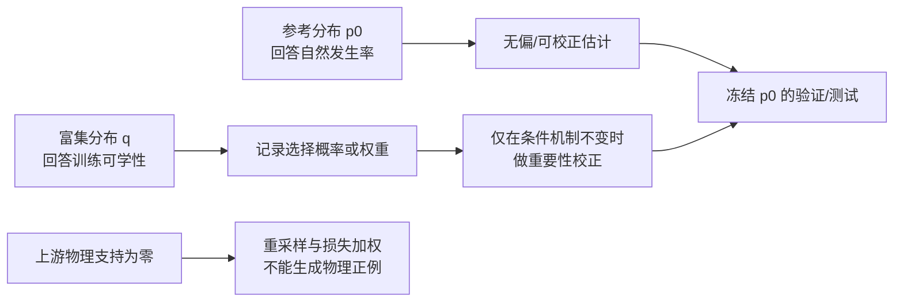

# 采样稀疏性诊断的方法学文献核验

> 检索与核验日期：2026-10-21  
> 范围：定向方法学核验，而非声称穷尽全部相关研究的系统综述。仅采用作者机构、期刊、会议或论文预印本原页；以下文献只能支持统计与机器学习方法选择，不能替代本项目的弹药、目标和毁伤物理标定。

## 1. 结论先行

现有方法学文献支持把本项目的问题拆成三个彼此不能混淆的任务：

1. **估计基准分布下的真实稀有概率**：应冻结参考分布 `p0`，采用标准蒙特卡洛、子集模拟或带权重要抽样；富集采样不能直接冒充自然发生率。
2. **为神经网络获得足够的正支持**：可以另建富集训练分布 `q`，但必须保留选择概率、设计权重或至少明确其与 `p0` 的差异，并在独立的 `p0` 验证/测试集上报告性能。
3. **判断零值来自哪里**：长尾损失、过采样和 ordinal head 只能利用已经存在的上游信息；当几何命中或能量沉积恒为零时，它们不能创造物理正例。这一点是由本项目的因果结构直接推出的工程结论，并非以下通用论文已经替本项目证明。

因此，文献并不支持“把最终标签配平后即可宣称物理分布全面”的做法。它支持的是：先恢复并验证物理支持域，再将**发生率估计**与**训练富集**分开。

## 2. 方法与本项目的适用边界

| 主题 | 经核验的原始来源与核心主张 | 对本项目可支持的做法 | 不能据此声称的结论 |
|---|---|---|---|
| 稀有事件模拟 | Au 与 Beck 将小失效概率写成一系列较大条件概率的乘积，并用 MCMC 估计这些条件概率。[CaltechAUTHORS 原页](https://authors.library.caltech.edu/records/m7b6w-kbc81)，DOI: [10.1016/S0266-8920(01)00019-4](https://doi.org/10.1016/S0266-8920(01)00019-4) | 若经验证的基准模型下确有稀有毁伤，可用中间事件，如“几何可达→部件命中→穿透→阈值”，提高估计效率；最终仍要还原 `p0` 下的概率。 | 不能证明当前恒零是自然规律；也不能用人为定义的中间事件取代物理标定。若当前模型在支持域内确定为零，子集模拟没有可追踪的稀有终事件。 |
| 安全重要抽样 | Owen 与 Zhou 研究混合提议分布、控制变量和方差上界，用于降低重要抽样偶发的大方差风险。[JASA 原页](https://www.tandfonline.com/doi/abs/10.1080/01621459.2000.10473909)，DOI: [10.1080/01621459.2000.10473909](https://doi.org/10.1080/01621459.2000.10473909) | 将若干定向/姿态/接触区富集流与一部分 `p0` 防御性混合，并保存每例 `p0/q`，比完全抛弃 `p0` 更稳健。 | 不能在未知 `p0`、未知 `q` 或无共同支持时保证可校正；不能校正仿真物理、目标几何或毁伤树本身被改变造成的机制差异。 |
| 协变量偏移 | Sugiyama 等把“训练与测试输入分布不同，而 `p(y|x)` 不变”定义为 covariate shift，并证明其 IWCV 在相应假设下无偏。[JMLR 原页](https://www.jmlr.org/papers/v8/sugiyama07a.html) | 富集 Train、冻结 `p0` Val/Test 时，可把 IWCV 作为模型选择候选，前提是标签机制相同且密度比可估。 | 改变源轴、物理参数、目标模型或毁伤树会改变 `p(y|x)`；这不再只是协变量偏移，不能靠权重把旧标签“校正”为新物理。 |
| 长尾损失 | Cui 等提出按“有效样本数”重加权的 class-balanced loss，并在长尾图像基准上验证。[CVPR 官方页](https://openaccess.thecvf.com/content_CVPR_2019/html/Cui_Class-Balanced_Loss_Based_on_Effective_Number_of_Samples_CVPR_2019_paper.html) | 当每个任务已有足够、可信且覆盖多区域的正例后，可把它作为训练基线，与普通 BCE/ordinal loss 比较。 | 该论文没有证明损失重加权可解决零正例、上游零剂量、标签定义错误或几何支持缺失。对常数标签，任何监督损失都没有类别内判别信息；这是可辨识性的逻辑限制。 |
| 不平衡评估 | Saito 与 Rehmsmeier 的模拟和再分析表明，在强不平衡二分类中 ROC 图可能给出误导性的直观印象，PR 图能更直接反映正预测可靠性。[PLOS ONE 原文](https://journals.plos.org/plosone/article?id=10.1371/journal.pone.0118432) | 每个 KMFC 任务报告 prevalence、PR 曲线/AUPRC、precision、recall，并同时报告概率校准；把 always-negative 与学习模型明确比较。 | AUPRC 随基准发生率变化，富集 Train 上的 AUPRC 不能代表 `p0` 部署性能；PR 也不能弥补验证集只有极少正例造成的大不确定性。 |
| 有序回归 | Cao、Mirjalili 与 Raschka 的 CORAL 用共享权重约束多个二元子任务，给出 rank monotonicity/一致置信分数的理论保证。[arXiv 原页](https://arxiv.org/abs/1901.07884) | 每一毁伤大类可编码为累计事件 `P(level≥1)`、`P(level≥2)`，用单调约束保证等级 2 不会超过等级 1；四类之间仍可重叠。 | CORAL 不会自动证明 Level 1/2 的工程语义正确；若旧标签不满足嵌套关系，必须先修复标签定义和重新生成，不能仅靠网络输出层掩盖冲突。 |
| 两阶段/门槛模型 | Mullahy 的 hurdle count model 用一个模型决定零或正，再对条件正值使用零截断计数分布。[Journal of Econometrics 原页](https://www.sciencedirect.com/science/article/abs/pii/0304407686900023)，DOI: [10.1016/0304-4076(86)90002-3](https://doi.org/10.1016/0304-4076(86)90002-3) | 可作为结构类比：先预测“是否可达/是否产生正剂量”，再预测条件毁伤等级或连续严重度；这与本项目的几何—能量—树分层相符。 | 原论文处理计数数据，本项目标签是概率/有序等级；不能直接套用其似然函数，也不能把“结构零”和“抽样未观察到的零”未经验证地混为一类。 |
| 全局敏感性 | Sobol' 以方差分解和 Monte Carlo/准 Monte Carlo 估计输入及输入组对输出的全局影响。[ScienceDirect 原页](https://www.sciencedirect.com/science/article/pii/S0378475400002706)，DOI: [10.1016/S0378-4754(00)00270-6](https://doi.org/10.1016/S0378-4754(00)00270-6) | 在修复支持域后，对弹型、速度、方向、姿态、接触区、源轴语义和树参数做全局/分组敏感性分析，识别交互项，而非只做单因素调参。 | Sobol 指数依赖所指定的输入分布；若把不物理的范围设得很宽，它衡量的是该人为设计下的模型方差贡献，不是现实因果贡献。恒零输出也没有可解释的输出方差。 |
| 二项比例区间 | Newcombe 比较了七种单比例置信区间，并指出常用简单近似存在覆盖率问题；score 类区间表现更可靠。[Wiley DOI](https://doi.org/10.1002/%28SICI%291097-0258%2819980430%2917%3A8%3C857%3A%3AAID-SIM777%3E3.0.CO%3B2-E) | 对每一阶段的成功数/试验数报告 Wilson/score 区间；`0/n` 应报告上界，不能写成“真实概率等于 0”。 | 区间只对应所抽取的 `p0` 与当前模型版本；存在自适应采样、簇相关、共享随机种子或重复轨迹时，朴素独立二项区间可能过窄。 |

## 3. 对当前项目最关键的推论

### 3.1 “稀有”与“支持缺失”必须分开

令 `h_theta,T(x, ω)` 表示在固定物理模型 `theta` 和毁伤树 `T` 下的毁伤事件。参考发生率为

\[
\pi_0 = \mathbb{E}_{x\sim p_0,\,\omega}\left[h_{\theta,T}(x,\omega)\right].
\]

若 `π0` 很小但大于零，子集模拟或重要抽样可以提高估计效率。若当前允许域内因几何方向、接触面或上游剂量而有 `h=0`，改变损失权重、复制零样本或仅增大同分布样本量都不会恢复支持。要区分二者，必须做分阶段计数和受控反事实，而不能只看最终标签直方图。

### 3.2 富集 Train 与参考概率必须双轨保存

在 proposal `q` 覆盖目标 `p0` 的相关支持，且标签机制没有改变时，重要抽样恒等式为

\[
\mathbb{E}_{p_0}[h(X)] = \mathbb{E}_{q}\left[h(X)\frac{p_0(X)}{q(X)}\right].
\]

这给出项目级数据合同：

- `Reference/Val/Test`：从冻结 `p0` 产生，用于发生率、校准和最终泛化评价；
- `Enriched Train`：从可追溯的 `q` 产生，用于提高正例和边界覆盖；
- 每例保存 `sampling_stream`、`p0_probability`、`proposal_probability` 或可复算的选择规则；
- 任何改动 `theta` 或 `T` 的样本属于新标签机制，应版本化并重新生成参考集，不能与旧集只靠权重混合。

### 3.3 深度学习模型应匹配因果阶段

在物理支持恢复、标签语义批准之后，建议比较：

1. **单体基线**：每类两个累计 ordinal logits；四类独立输出，允许 KMFC 同时成立；
2. **两阶段模型**：`P(positive support | x)` 与 `P(level≥r | positive, x)` 分开；
3. **结构化模型**：显式监督“可达/命中/穿透/能量/树门”中间变量，并做单调约束。

这三种模型都应在冻结 `p0` 测试集上报告 PR/AUPRC、Brier 或 log loss、校准曲线、各等级混淆矩阵与有序违规率。若 Test 中正例太少，应首先增加独立参考样本或报告宽区间，而非从 Train 复制正例到 Test。

## 4. 建议的文献驱动实验顺序

1. **支持域审计**：逐阶段记录 `first_contact → component_intersection → penetration → positive_energy → level`，先辨认结构零。
2. **物理/坐标受控试验**：方向、姿态、接触区、源轴及弹型做配对因子试验；这一步回答“哪一层制造零”，不估计自然发生率。
3. **冻结参考设计**：经领域专家批准 `p0`、物理版本和树版本后，单独生成 Reference/Val/Test，报告每阶段比例及 score 区间。
4. **建立富集流**：优先使用防御性混合或可计算密度的 proposal；将估计权重与训练采样权重分开命名。
5. **训练与评价**：只有在每个任务已有可学习正支持后，再比较 class-balanced loss、两阶段模型和 ordinal head；用 `p0` 测试集给出最终结论。
6. **全局敏感性**：输出有非零方差且输入分布已批准后，再计算 Sobol/其他全局敏感性指标，报告其依赖的输入范围与分布。

## 5. 参考文献

1. Au, S.-K., & Beck, J. L. (2001). Estimation of small failure probabilities in high dimensions by subset simulation. *Probabilistic Engineering Mechanics, 16*(4), 263–277. https://doi.org/10.1016/S0266-8920(01)00019-4
2. Owen, A., & Zhou, Y. (2000). Safe and effective importance sampling. *Journal of the American Statistical Association, 95*(449), 135–143. https://doi.org/10.1080/01621459.2000.10473909
3. Sugiyama, M., Krauledat, M., & Müller, K.-R. (2007). Covariate shift adaptation by importance weighted cross validation. *Journal of Machine Learning Research, 8*, 985–1005. https://www.jmlr.org/papers/v8/sugiyama07a.html
4. Cui, Y., Jia, M., Lin, T.-Y., Song, Y., & Belongie, S. (2019). Class-balanced loss based on effective number of samples. *CVPR*, 9268–9277. https://openaccess.thecvf.com/content_CVPR_2019/html/Cui_Class-Balanced_Loss_Based_on_Effective_Number_of_Samples_CVPR_2019_paper.html
5. Saito, T., & Rehmsmeier, M. (2015). The precision-recall plot is more informative than the ROC plot when evaluating binary classifiers on imbalanced datasets. *PLOS ONE, 10*(3), e0118432. https://doi.org/10.1371/journal.pone.0118432
6. Cao, W., Mirjalili, V., & Raschka, S. (2020). Rank consistent ordinal regression for neural networks with application to age estimation. *Pattern Recognition Letters, 140*, 325–331. Preprint: https://arxiv.org/abs/1901.07884
7. Mullahy, J. (1986). Specification and testing of some modified count data models. *Journal of Econometrics, 33*(3), 341–365. https://doi.org/10.1016/0304-4076(86)90002-3
8. Sobol', I. M. (2001). Global sensitivity indices for nonlinear mathematical models and their Monte Carlo estimates. *Mathematics and Computers in Simulation, 55*(1–3), 271–280. https://doi.org/10.1016/S0378-4754(00)00270-6
9. Newcombe, R. G. (1998). Two-sided confidence intervals for the single proportion: comparison of seven methods. *Statistics in Medicine, 17*(8), 857–872. https://doi.org/10.1002/(SICI)1097-0258(19980430)17:8%3C857::AID-SIM777%3E3.0.CO;2-E

